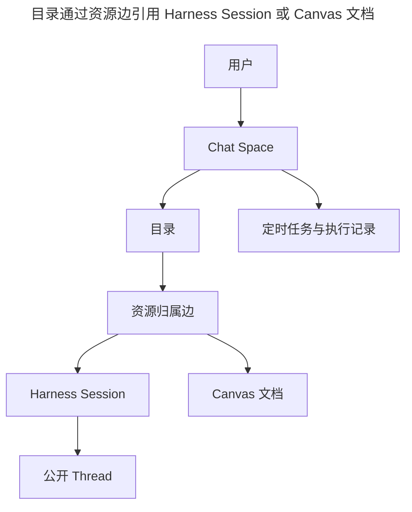
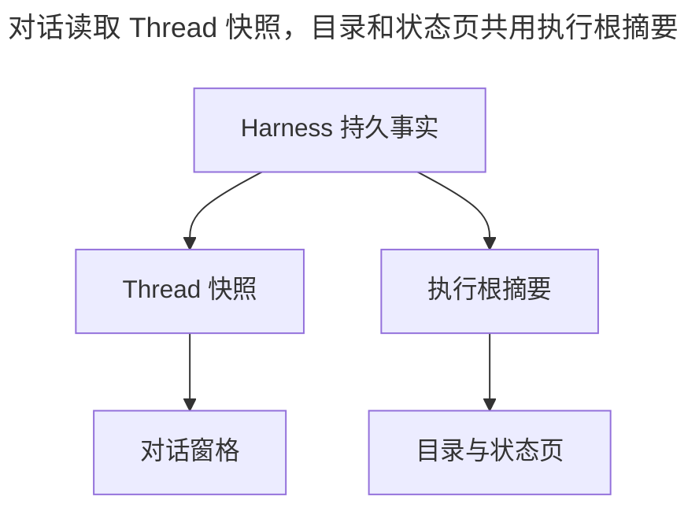

# KK Studio 1.3.0 · 产品设计与模型映射

**侧栏决定打开什么，窗格决定怎么摆。** 用户登录后进入自己的 Chat Space：左侧目录组织会话和画布，底部列出可用环境。Thread、画布和环境里的 VS Code 都进入同一套窗格，可以并排、切换或全屏。设置单独进入，返回时保留工作区。

这是 1.3.0 的设计。当前架构见[系统设计](system-design.md)。1.3.0 以空库初始化，新增账号密码登录，删除 Project/Issue、旧的 Chat 和画布主导航、独立历史树入口与全局待处理页；不保留旧路由、API、表或运行时双写。本文定义产品模型、服务端模型和接口，以下文档展开实现细节：

| 文档 | 回答的问题 |
| --- | --- |
| [Harness](workspace-harness.md) | 执行内核如何分层，库表与模型有哪些字段，输入如何推进，提供哪些接口？ |
| [交互与底层链路](workspace-interactions.md) | 每个用户动作改变哪些前端状态，调用什么接口，在哪个事务里改哪些数据，发出什么事件，失败时怎样表现？ |
| [视觉语言与组件体系](workspace-ui.md) | 颜色、间距、焦点、边框和动效遵守什么规则，由哪些共享组件承载，怎样用门禁防止样式回退？ |
| [保留、重构、删除与交付](workspace-delivery.md) | 现有代码哪些保留、重写或删除，重写必须保持哪些行为，按什么顺序交付和验收？ |

## 一次完整操作

在对话标题栏点「向右拆分」，新窗格默认显示「新会话」。直接输入并发送即可开始对话；也可以点目录里的「1.3.0 工作流」或左下的 VS Code 图标，再选择打开到哪个窗格。点任一窗格标题里的「全屏」可专注当前内容，点「退出全屏」或按 `Esc` 恢复原布局。

### 目录、状态和定时各做一件事

- **目录**是默认视图。筛选右侧的 `+` 只新建顶层目录；在目录的「…」里新建会话、画布或子目录，创建位置由该目录决定。每个空间至少有一个顶层目录；会话和画布共用顺序，子目录排列在资源之后。在完整目录树中用拖拽移动或排序。触屏按住再拖，直接滑动仍是滚动；拖到列表边缘可自动滚动。放在目录中间移入目录，放在相应行的边缘插到该行前后。新资源或直接拖入目录的资源放在最上面；新建资源时展开所在目录。Thread 按创建顺序排列，空目录只占一行。筛选只匹配名称，显示命中项及其上级目录；筛选时不能拖拽。目录选中只用底色；窗格切换和打开不改变目录的选中行或展开状态。
- **状态**只列当前空间的公开 Thread，按「需要你、运行中、等待、失败、空闲」分组，组内按最后活动时间倒序。当前空间有「需要你」时，「状态」标签显示圆点。状态变化不改目录排序；运行中使用黄色轮转图标并尊重减少动态效果，空闲不显示图标。
- **待处理**是侧栏顶部空间名右侧的收件箱按钮，汇总当前用户全部 Chat Space（含已归档）里的待审批、待回答等人工交互，同一执行根只列一行，每行标明所属空间；有待办时按钮显示数量，侧栏收起时按钮留在收起栏。点击条目进入所属空间，按其窗格布局走统一打开流程，在 Thread 输入框上方处理；打开归档空间不恢复它。插件后台任务不属于 Chat Space，只出现在管理员的待处理末尾；管理员看不到别人的私人空间。待处理只负责发现和跳转，决定只在 Thread 内的交互卡片里提交。
- **定时**管理当前空间的任务。名称是纯文本，下方只显示有效的下次运行时间；用开关启停，「…」只放「立即运行」和「编辑」。编辑弹窗左下角的「删除任务」删除任务及其执行记录，已产生的会话和 Thread 保留。点「执行记录」在任务下方展开，一次只展开一个任务，先看最新五条，「较新／较早」原地换页。每条显示时间和 Thread 标题；没有可打开的 Thread 时显示原因，不可点击。有 Thread 的记录和目录共用打开流程，不改变目录展开或选中状态。
- **新会话**在首条消息被接受前只保留为窗格草稿。从目录新建时绑定该目录，直接在空窗格输入时使用首个顶层目录。发送后同步创建 Session、`main` Thread 和目录项，在原窗格继续对话。采用空间的默认 Agent，Composer 保留模型、变体、执行环境和权限设置；空间还没有可用 Agent 时不能发送：有 Agent 可选时，入口打开空间的默认配置；一个 Agent 都没有时，管理员的入口打开 Agent 设置，普通用户只看到原因。非空草稿被替换或关闭前须确认。

### Chat Space

每个空间属于创建它的用户，只有该用户能看到。点击侧栏的空间名切换。「+ Chat Space」填写名称后创建并进入新空间，初始有一个默认目录和一块可直接输入的窗格。用户首次登录且没有任何空间时，浏览器按当前语言创建一个空间和默认目录。切换空间后按各自的 ID 恢复本机布局。归档当前空间后切到其它活跃空间；每个用户至少保留一个活跃空间。「已归档」里可以恢复并打开。归档不删除内容、改布局、停任务或改变深链访问权限；从「待处理」打开已归档空间时，保留归档状态和最近活跃空间记录。空间只归档，不提供删除；其中的内容按普通资源逐项删除。

空间菜单用底色标记当前空间，铅笔跟随悬停或键盘高亮的空间行。点其它空间名称可切换；点铅笔或按 F2 可在原地改名，不切换空间。当前空间也可点名称改名。按 Enter 或点保存提交；Esc 取消，点菜单外或按 Tab 关闭且不保存。空名或重名保留输入并提示。改名不改变 ID、资源或布局。默认配置也从同一入口管理。设置独立于空间，返回时保留空间和布局；关闭有未保存改动的设置表单时先确认。

### 标题内切换

空间够就并排显示，空间不足才用当前标题切换窗格。单窗格时标题只展示内容名称。移动端左侧打开侧栏，标题右侧是拆分和全屏；拆分按钮为 44×44，菜单只选方向。切换菜单按位置列出所有窗格，也能关闭当前窗格；取消菜单时归还焦点。切换按钮的可访问名称包含窗格字母和标题。

## 产品如何映射到执行模型 {#product-mapping}

**Chat Space 是实体，工作区不是。** [Chat Space 管理模块](#product-persistence)负责归属、目录和定时任务；界面上的工作区是侧栏与窗格的组合。`workspace_id` 指向 `chat_space.id`，不另建 Workspace 实体。Harness 只收到执行所需的身份、历史切点或命令，不认识侧栏和窗格。



箭头表示归属或引用，不表示级联删除。Session、Entry 与 Thread 的字段及两棵树见 [Harness 库表结构](workspace-harness.md#model)。窗格绑定保存在浏览器，不是图里的资源归属边。

| 产品动作 | 产品侧改变什么 | Harness 侧改变什么 |
| --- | --- | --- |
| 拆分窗格、输入草稿 | 只改本机布局和草稿 | 无写入 |
| 发送首条消息 | 在所选目录登记新 Session 的归属；接受成功后原窗格绑定返回的 Thread ID | 同事务创建 Session、`ROOT`、`main`，接受首批 Command 并登记 Work |
| 发送后续消息 | 原窗格和目录不变 | 给已有 Thread 接受命令，不创建 Session |
| 从回合末尾分支 | 同一目录项下多一条公开 Thread | 在同一 Session 创建独立执行根，挂到选定的 `TURN_END` |
| 从回合末尾新建会话 | 增加 Session 的目录归属边 | 复制有效历史到新 Session，创建 `main`；不复制在途执行 |
| 打开 Thread、画布或 VS Code | 窗格绑定相应资源；不改变资源归属 | Thread 读取快照；画布和 VS Code 分别走自己的服务 |
| 触发定时任务 | 记录触发或提交结果；不自动打开窗格 | 使用同一新建、分支或继续入口，有产出时返回 Thread ID |
| 归档 Chat Space／关闭窗格 | 只改变空间是否出现在活跃列表，或改变本机布局 | 不停止 Thread，不删除历史 |

### 资源归属

**Resource 不是 Thread 的新名字，也不是插件存储。** `ChatSpace` 是资源的归属边界。`Folder` 是容器；`Session` 和 `Canvas` 是本版可放入目录的两种 `Resource`；可见 `Thread` 是 Session 内的执行线。未来加 Markdown 可增加一个明确类型及 renderer，不在 1.3.0 增加空白入口、泛型表或新的插件 HTTP SPI。

**ChatSpace 是用户数据的边界。** 每个空间属于一个用户，空间里的目录、会话、Thread、画布、定时任务和附件只对所有者可见，管理员也不例外。工作区接口校验路径中的空间属于当前用户、资源属于该空间，否则一律按不存在处理，深链和事件不会串到别的空间或用户。执行类接口按 Thread 所属空间的所有者授权，见[用户与登录](#accounts)。

| 类型 | 拥有的事实 | 打开行为 |
| --- | --- | --- |
| ChatSpace | 所有者、目录边界，默认 Agent、环境和权限，归档时间 | 从侧栏创建、切换、归档和恢复；各空间的视图独立。 |
| Folder | 父目录、同级顺序、名称 | 展开或折叠，永不打开窗格。 |
| Session | 对话标题、Agent 身份、历史树 | 目录行展开 Thread。分享对话时链接始终指向具体 Thread。 |
| Thread | 执行控制、当前历史头、版本、当前/下次生效的模型和环境 | 复用 `ThreadPanel`、Composer、实时 Timeline 和 Footer。内部子代理、压缩执行线只在其所属对话中显示。 |
| Canvas | 画布文档、图、节点、引用、运行 | 复用现有 Canvas editor runtime。同一画布的各窗格共享按 Canvas ID 驱动的服务器文档，各自有选中项、缩放和平移；并发仍使用 Canvas revision 与 patch。 |
| 环境视图 | 环境 ID 和具体功能 | 从侧栏底部按环境打开。目前显示 VS Code，不登记为 ChatSpace 的目录资源。 |

**Session 固定 Agent；Thread 可以改变模型、变体和环境，不换 Driver。** Agent 以名称为主键，名称创建后不可修改。创建 Session 时，Agent 名称写入首条 Thread 的根设置，同时记录在目录边上；目录边对 Agent 的 RESTRICT 外键阻止删除仍被使用的 Agent。已有 Thread 的命令不接受更换 Agent，另一个 Agent 用新 Session。Agent 的后续编辑仍按现有运行时解析规则生效，已接受的回合继续执行其冻结计划。1.3.0 只投影现有内置 Driver。设置切换随下一条用户消息接受或在运行时安全点应用；同一 Session 的可见 Thread 共用缓存隔离身份，不用 Thread ID 替代。

### 前端路由、布局和草稿

产品只有 `/`、`/chat-spaces/:spaceId`、`/settings/:section` 三类壳层路由。登录是外壳状态，不是路由：未登录时任何地址先显示登录，登录后留在原地址。`/` 跳到最近打开的活跃空间。可分享地址为 `/chat-spaces/:spaceId?thread=:id` 或 `?canvas=:id`，两者互斥。打开前用工作区接口确认资源属于该空间，未知或不属于该空间的资源返回 404；它与点击目录行走同一个 `open`，不会重建布局。设置返回原空间；直接打开设置页时回到最近活跃空间。切换窗格不改变浏览器历史。

```ts
type ResourceRef = { kind: 'SESSION' | 'CANVAS'; id: UUID }
type Target = { kind: 'THREAD'; sessionId: UUID; id: UUID }
  | { kind: 'CANVAS'; id: UUID }
  | { kind: 'DRAFT'; id: UUID; folderId: UUID }
  | { kind: 'ENVIRONMENT'; environmentId: UUID; view: 'VSCODE' }
type Layout = { paneId: UUID }
  | { splitId: UUID; axis: 'X' | 'Y'; ratio: number; first: Layout; second: Layout }
type PaneBindings = Partial<Record<UUID, Target>>
```

- **边界**：窗格接收标题、可选操作和内容容器，只处理布局、聚焦与展示。工作区维护 `paneId → Target`，按 `Target` 选择 renderer；无资源绑定时显示可直接输入的「新会话」。资源入口调用 `open(target)`，域运行时不依赖布局、路由或点击来源。
- **打开**：目录（包括目录菜单里的新建会话和新建画布）、状态、执行记录和环境都用同一套窗格打开流程；窗格里的动作（发送首条消息、分支、从回合末尾新建会话）在原窗格继续。当前窗格未打开资源且没有草稿时直接打开；否则暂时冻结窗格，每个窗格中央显示位置字母，当前窗格高亮。按字母或点击中央按钮选择，`Enter` 选当前窗格，`Esc` 取消；空间不足时显示所有窗格的缩略布局。替换含草稿的新会话前仍须确认。打开不改布局；已在别处打开的 Thread 或同环境同功能移到目标窗格，原窗格回到「新会话」。同一画布可打开独立视角。Thread 草稿与 Thread ID 绑定，未发送的 Session 草稿与窗格绑定。
- **拆分**：`split(paneId, axis)` 只增加一个聚焦的窗格，原窗格不变，初始比例为 1/2。桌面点方向立即拆分；窄屏点「拆分窗格」后选方向。新窗格不绑定资源，默认显示新会话。
- **布局**：最多 8 个叶子。递归计算最小宽高：同轴相加加 1px 分隔线，异轴取较大者，每个叶子 320×240 CSS px。实际可见空间不够时压扁为一个视图，保留原树与比例；窄态仍可逻辑拆分，回到宽态再铺开。宽态在当前叶子放不下两个最小子节点时禁用该方向，给出原因。分隔线拖拽或方向键钳制可见比例，双击回到允许范围内最接近 1/2 的位置。容器尺寸变化只钳制实际展现，不把临时比例写回。
- **标识、关闭与交换**：多个窗格按显示顺序标为 `A`–`H`，当前窗格的字母有底色。桌面拖字母交换窗格，不交换比例。关闭窗格时用兄弟子树替换父节点，若关闭的是当前窗格，则聚焦兄弟子树的第一个窗格。关闭窗格不删除资源、不停止 Thread；删除资源只解除对应绑定，窗格回到「新会话」。唯一窗格不显示字母或关闭按钮。
- **全屏**：只在工作区显示当前窗格，暂时隐藏侧栏和其它窗格。标题上的「退出全屏」或 `Esc` 恢复原布局。仅改变显示，不改窗格树、比例、绑定或草稿。切换、全屏和交换时不得重新加载已打开的工作台。
- **存储**：每浏览器按用户和 ChatSpace 保存布局树、绑定、聚焦 ID、目录展开状态和侧栏宽度。窄屏显示与全屏是临时状态，不另存副本。失效的绑定清除后保留原窗格。草稿文本不随布局同步，不保存到服务端。视图交互状态按 pane ID 留在浏览器，不对其他打开的视图广播选择或滚动。
- **键盘**：目录用 roving tabindex。`j/k` 选择，`h/l` 收起、展开或移动到父/子，`r/d` 改名、确认删除；保留方向键、Enter、F2、Delete 和上下文菜单键。改名输入框的可访问名称包含原名称，`Home/End` 留给输入框。标题聚焦时用 `v/s` 向右或向下拆分。输入、下拉、组合输入和无关修饰键照常工作，菜单用自己的方向键。
- **斜杠命令**：在输入框中键入 `/` 时显示命令，之后只在有匹配时显示；无匹配立即收起，删改回有匹配的文字时自动出现，不移动光标。命令输入只接受以 `/` 开头的单段纯文本，后续空白和路径分隔符都回到普通输入。禁用的匹配项仍显示原因。无匹配的文字和 `/files/workspace/README.md` 这类路径都可正常发送。由 Composer 统一判断；新会话首条消息和已有 Thread 的提交入口不再按开头的 `/` 拒绝正文。`+` 仍可手动打开命令列表。

### 环境视图和设置

侧栏底部列出全部环境。环境名旁的圆点显示连接状态：绿色就绪、黄色连接中、灰色离线或不可用。只显示当前可执行的操作，使用带名称的图标按钮。每个操作绑定「环境 ID + 功能」，在选定窗格打开对应视图。环境授权和实时可用性沿用 Environment；打开时按对应功能复验。1.3.0 只接 VS Code，VNC 是后续独立功能，不占用当前界面。

VS Code 复用现有的 Daemon 连接、视图绑定、退出确认和释放流程。一个窗格展示一个工作台，由窗格标题切换，不再叠加 Studio 的 IDE 标签。仅隐藏或全屏时，嵌入宿主保持挂载；不要移动导致 iframe 重载的 DOM 节点。Composer 的 `/files` 打开当前环境的 VS Code，也走同一流程。

- **设置**：侧栏底部是头像和齿轮；展开时头像在齿轮左边，收起时头像在齿轮下面。头像显示用户名首字母，点开只有「修改密码」和「退出登录」。管理员看到全部分类：界面 → 偏好；Harness → Agent、模型、提供商、技能包、环境、MCP 服务；系统 → 常规、用户、插件、AI 运行时、工具与权限、环境默认值、后端网络、存储与媒体、高级、同步。普通用户只看到界面。分类只在桌面左栏或窄屏选择器显示，正文不重复标题；左箭头返回对话。系统设置继续由已有 schema 和聚合版本驱动；保留校验、重置、提交失败及冲突。同步保留选择导出、导入预检和确认流程。全量部署信息放常规，其中的 Studio 版本由前端构建时注入，与项目版本一致；浏览器偏好只在界面。
- **共享组件**：使用现有 `Button`、`IconButton`、`ResourceCard/Grid`、`CreateCard`、`StateBlock`、表单和确认弹窗。普通和紧凑按钮采用共享尺寸，触屏关键操作至少 44px。文字按钮常驻底色，只有图标的按钮平时透明；按钮悬停、目录与标签选中用底色，不画装饰边框。文本、选择控件和 Composer 在指针或键盘聚焦时统一使用 `--border` 的 1px 轮廓；普通按钮只在键盘焦点可见时显示轮廓，保留校验错误的语义。卡片 label/value 字号一致，用色与字重分层。只有确有空值含义的字段才显示「无 / 默认」。字段说明只放在标签后的 `?` 提示里，标签和输入之间、输入下方不放常驻说明；不折叠有用的表单段。日期和时间用与下拉框同外观的选择器，不用浏览器原生控件。规则细节见[视觉语言与组件体系](workspace-ui.md)。
- **编辑器**：Agent 的工具、技能、子 Agent 直接展开；模型费率规则和倍率分段直显，配置 JSON 保持可见。模型默认变体必选。输入上限留空时显示「跟随上下文窗口」；名称、模型 ID 和输入类型只在校验失败时提示。费率时段的时间为 24 小时制；结束时间的小时列末尾有 24，选中即 `24:00`，与同日 `00:00` 区分。修改已生效方案会改变历史费用展示，这条提醒放在「价格方案」后的 `?` 里。Anthropic 的 mid-conversation system message / per-message effort 不作为用户开关：适配器按模型、能力和端点决定，使用现有明确的协议回退。单纯隐藏 UI 不改变现有已保存值、构造或发送路径；在适配器的能力判定与既有策略等价性通过协议测试后，1.3.0 空库契约移除用户可编辑字段。
- **环境 / 插件**：环境动作顺序为安装 / 覆盖、管理、编辑、删除；管理直接显示主机、配置与事件，事件消息按当前语言显示。安装覆盖会中断正在执行的调用，须明示；编辑配置不重装。插件仅在配置未应用或应用失败时显示版本差异提示；外部连接状态是独立事实。

## 用户与登录 {#accounts}

**账号密码登录，两种角色，每个 Chat Space 属于一个用户。** 不提供自助注册、单点登录或找回密码；忘记密码由管理员重置。

- **内置管理员**：建库时写入管理员 `kkstudio`，初始密码与用户名相同。首次部署只允许部署者访问，登录修改初始密码后再开放端口。用户只能由管理员在设置 → 系统 → 用户中新建；管理员可以修改任何用户的用户名、密码和角色，也可以禁用或重新启用账号，不删除用户。重置密码只作废旧凭据和既有登录。
- **账号**：用户名 1–32 个字符，只含小写字母、数字和 `.`、`_`、`-`，以字母或数字开头；全局唯一。空间、上传和登录都引用用户 ID，改名不影响它们，之后用新用户名登录。头像显示用户名首字母的大写。密码 8–128 个字符，只保存加盐的 PBKDF2-HMAC-SHA256 哈希，哈希串带算法标识，以后可以换算法。用户资料存为 JSON 对象，1.3.0 不定义字段。
- **角色**：管理员（`ADMIN`）和普通用户（`USER`）都使用自己的 Chat Space，以及全局的 Agent、模型和环境（包括 VS Code）。只有管理员能修改 Harness 和系统设置、导入导出配置、管理用户，以及看到和处理插件后台任务；普通用户的设置只有「界面」。至少保留一名启用的管理员。
- **禁用账号**：禁止登录并作废全部登录 Cookie；定时任务暂停，不再自动触发。已提交的回合不强制停止，空间、历史、附件、任务和执行记录都保留。重新启用账号后可登录，任务保持暂停，由所有者逐个恢复。禁用不赋予管理员读取账号内容的权限。
- **隔离范围**：用户之间隔离的是 Studio 里的数据。Agent、模型、提供商、技能包、MCP 服务和环境是全局共享的配置；环境是共享机器。工具和 VS Code 能访问 Daemon 运行账号有权读取或修改的文件，不按 Studio 用户隔离。只给可信的人开账号；不要把 Studio 服务的数据、配置和凭据放在这些环境账号可读的位置。
- **登录状态**：登录成功后，服务端生成 256 位随机令牌，写入 `HttpOnly`、`SameSite=Strict`、`Path=/` 的 cookie，HTTPS 下另加 `Secure`；数据库只保存令牌的 SHA-256。登录 30 天后失效，不自动续期。退出删除本次登录；修改密码删除该用户的其它登录；管理员重置密码删除该用户的全部登录。HTTP 每次读取当前登录和角色；WebSocket 握手、订阅时校验，并至少每分钟复核一次登录与订阅权限，登录失效则关闭连接，角色变化则移除不再授权的订阅。
- **跨站防护**：登录、退出、非 GET/HEAD 的 Studio API 请求与浏览器 WebSocket 握手必须携带唯一且有效的 `Origin`，且与 Studio 的 scheme、host、有效端口完全一致。GET/HEAD 不改变业务状态，不要求 `Origin`；IDE 数据面继续使用自身的 HTTP 准入规则，共用相同的精确源比较。部署只信任受控代理转发的外部协议、主机和端口；边缘代理覆盖客户端送来的转发头。开发代理不改写浏览器的 Host 或 Origin；脚本和 E2E 使用 Cookie 时也须为这些受检请求发送 Studio Origin。
- **登录尝试**：用户不存在和密码错误返回同一个错误；用户不存在时同样计算一次哈希，耗时一致。不锁定账户；部署到公网时在反向代理上限制 `/api/auth/login` 的请求频率。

浏览器的 `/api/**`、`/ws/events` 和 `/ide/**` 默认要求登录。SPA 外壳、静态资源和登录端点公开，读取当前用户无有效登录时返回 401。目标主机下载安装脚本沿用一次性安装码，卸载脚本沿用现有契约；`/ws/daemon` 用环境令牌，`/internal/**` 用节点 HMAC，不使用浏览器登录。登录后按资源归属授权：

| 入口 | 授权 |
| --- | --- |
| `/api/chat-spaces/**` | 空间的所有者。 |
| `/api/harness/**` | Thread 或 Session 所属空间的所有者；插件后台任务只限管理员。 |
| `/api/canvas/canvases/{id}/**` | 画布所属空间的所有者；画布函数目录对所有用户开放。 |
| `/api/ide/**`、`/ide/**` | 登录用户可为就绪的环境打开 VS Code。服务端将视图绑定到发起连接及其用户 ID；控制面与数据面都校验用户 ID 和已有的浏览器会话绑定，复用旧绑定时也校验。把文件发送到视图还须通过会话附件授权。 |
| `/api/platform/storage/uploads/**` | 预约记录上传者；完成、取消只限上传者。 |
| `/api/platform/config-sync/**`、管理和配置接口 | 只限管理员，含读取配置、同步导出和导入预检；不按 HTTP 方法分类。 |
| `/api/platform/agent-summaries`、`/api/platform/model-summaries`、`/api/platform/environment-summaries` | 登录用户可读。分别返回 Agent 的执行选择、模型及可选变体、环境的就绪状态和能力，不含凭据、请求头或配置原文。 |
| 其余 `/api/platform/**` | 默认限管理员；仅逐条开放调用已授权运行时所需的端点。 |
| `/api/users/**` | 只限管理员。 |
| `/ws/events` | 订阅按上面的规则校验；`environments` 对所有用户开放，`interactions` 只推送本人的执行根，管理员另含插件后台任务。 |

**附件只能经由持有它的会话或画布取址。** 不提供凭单个 Blob ID 取址的通用接口。取址同时检查资源归属与 Blob 持有边；两者任一不满足都返回 404。消息只能附带本人的上传；正文里的 `resource://files/<uuid>` 只有在本人的会话、画布或上传已经持有这个文件时才登记，否则按不存在的文件处理。同一个 Blob 可被多份资源持有，不能从 Blob ID 反推唯一所有者。定时任务按所属空间运行，不需要所有者在线。

## 服务端模型和一致性 {#product-persistence}

工作区由新的 apps/workspace 模块实现，取代 apps/chat。它拥有下表五张表，通过 Harness 编排接口创建、分支和删除 Session，通过 Canvas 运行时创建和删除画布，在同一事务中写领域对象和目录边；提交后不存在没有归属的用户可见会话或画布。内部 Session（插件后台任务）不登记。保留 `harness_session`、`harness_entry`、`harness_thread` 的执行和历史职责及 Canvas 子表；按所有者字符串派发的会话所有权与 Agent 引用扩展点整体删除；Harness、Canvas 和 IDE 的接口改经平台层的一个所有者查询端口授权，由 apps/workspace 唯一实现：给定 Session 或画布，返回所属空间和用户；再由请求所到的领域核对它持有的文件。**不把 `durable_work` 的无外键多态键用于资源所有权。**

| 表 | 字段与约束 |
| --- | --- |
| `chat_space` | `id uuid PK`、`owner_user_id FK → studio_user(id) RESTRICT`、`title`、`title_key`、可空 `archived_at`、可空 `default_agent_name FK → agent(name) RESTRICT`、可空 `default_environment_id FK → environment(id) ON DELETE SET NULL`、`default_yolo_enabled`、`version bigint`、`tree_version bigint`。`UNIQUE(owner_user_id,title_key)`：名称去除首尾空白、忽略大小写后在同一用户内唯一，归档空间仍占用名称。 |
| `workspace_folder` | `id uuid PK`、`workspace_id FK → chat_space`、可空 `parent_id`、`name`、`name_key`、`position int`。`UNIQUE(workspace_id,id)`；复合 FK `(workspace_id,parent_id)` 保证父目录同一空间；同级目录名忽略大小写唯一，根目录用 NULLS NOT DISTINCT 同样约束。禁止以自身或后代为父。 |
| `workspace_resource` | `workspace_id`、`folder_id`、`position int`、`session_id`、`canvas_id`、`agent_name`。`id uuid PK CHECK(id = coalesce(session_id, canvas_id))`；`CHECK(num_nonnulls(session_id,canvas_id)=1)`；`agent_name` 在且仅在 Session 行非空，`FK → agent(name) RESTRICT`。`UNIQUE(session_id)`、`UNIQUE(canvas_id)`，两列各自是到领域主键的 RESTRICT FK；`(workspace_id,folder_id)` 是到目录的复合 FK；另建 `UNIQUE(workspace_id,session_id)` 供定时引用。Session 标题沿用 `harness_session.name`，Canvas 标题在 Canvas 文档；目录不保存影子标题。 |
| `workspace_schedule` | `id uuid PK`、`workspace_id FK`、`title`、`message`、`enabled`、`trigger`、`time_zone`、可空 `next_due_at`、`version`；目标用互斥的列组。新建目标绑定 `(workspace_id,folder_id)` 与 `agent_name`；分支/续作绑定 `(workspace_id,session_id)` 与 `(session_id,thread_id)`，分支额外绑定 `(session_id,turn_end_id)`；继续与新建不接收 `turn_end_id`。目标引用均为 RESTRICT。SQL CHECK 约束互斥列组，业务事务验证 `TURN_END` 类型和可见路径。 |
| `workspace_schedule_run` | `id uuid PK`、`schedule_id FK ON DELETE CASCADE`、`occurrence_key`、`scheduled_at NOT NULL`（手动运行用请求时间）、可空 `started_at`、本次运行的 `time_zone`、`result`（`SUBMITTED`、`SKIPPED` 或 `NOT_SUBMITTED`）、`reason`、可空 `output_thread_id`。`UNIQUE(schedule_id,occurrence_key)`；按 `(schedule_id,scheduled_at DESC,id DESC)` 建分页索引，另为非空 `output_thread_id` 建索引。产出链接用 `ON DELETE SET NULL`，删除产出只清链接，不删执行记录；删除任务时其记录随之删除。 |

用户和登录由平台层实现：

| 表 | 字段与约束 |
| --- | --- |
| `studio_user` | `id uuid PK`、`username varchar(32) UNIQUE`（CHECK 用户名规则）、`password_hash`、`profile jsonb NOT NULL DEFAULT '{}'`（CHECK 为 JSON 对象）、`role`（CHECK 为 `ADMIN` 或 `USER`）、可空 `disabled_at`、`created_at`、`updated_at`。V1 写入内置管理员 `kkstudio`，密码哈希预先算好。 |
| `login_session` | `token_hash bytea PK`（登录令牌的 SHA-256）、`user_id FK → studio_user ON DELETE CASCADE`、`created_at`、`expires_at`；按 `user_id` 建索引。登录时顺带删除该用户已过期的记录。 |

`storage_upload` 增加 `owner_user_id FK → studio_user RESTRICT`。

`position` 为各自同级序列内从 0 起的整数，使用可延迟唯一约束保证批量重排。所有目录结构写按 ChatSpace 行 `FOR UPDATE` 串行，在同一事务内更新两侧顺序、递增 `tree_version`、保留至少一个顶层目录并校验无环；改名不改变结构，不递增 `tree_version`。同一空间内移动只改归属边，历史 ID、Canvas revision、定时目标和深链不变；不能跨空间移动。删除先取 ChatSpace 行锁，再取 Harness 锁。已有 Thread 的发送、停止、审批和问卷回答不取 ChatSpace 锁：发送和停止与删除取同一 Harness 树锁；审批和问卷回答只锁目标 Thread 行，不锁执行根，删除同样锁住闭包内的全部 Thread 行。删除在锁内复验没有待处理命令、交互或执行，晚到的一方失败而不会穿透。运行状态更新不获取空间锁、不改目录顺序。同一 Session 内公开 Thread 名称唯一，分支和改名在 Session 行锁内校验。归档先锁所有者的 `studio_user` 行，再锁空间行，避免并发归档清空该用户的活跃列表；归档只改 `archived_at` 和版本。改变角色或账号启用状态时先取得同一把用户管理事务锁，再锁用户行，保证至少一名启用的管理员。登录签发令牌前在用户行锁内复验启用状态和密码哈希；禁用和重置在同一把用户行锁内撤销登录。

### Thread 状态是投影，不是第二套状态机



在同一个一致快照上用执行根和关联运行事实算出一个状态与一个可选 `reason`；按以下优先级覆盖。数据库不新增 `status` 列，不从协议信息或文字中猜测。

| 优先级 | UI 状态 | 权威事实 |
| --- | --- | --- |
| 1 | 需要你 | 工具审批或输入挂起；存在实际需要用户处理的退出确认或未知结果。子 Agent 的人工阻塞也归到可见根 Thread。 |
| 2 | 运行中 | 执行树中有正在执行、正在结算或已可领取的有效 Work；自动重试到点已可领取。只要有一条分支能推进，整体就是运行中。 |
| 3 | 等待 | 没有可推进的工作，但存在明确的阻塞条件：环境未就绪、等待子执行/退出确认、未来的 `retryAt`。能从服务端解除的等待不给伪按钮。 |
| 4 | 失败 | 没有义务继续运行且当前 head 的 `TURN_END` 是 `FAILED`。旧失败、正在重试、用户停止不算失败。 |
| 5 | 空闲 | 无以上事实。可另外保留已有的停止标记和理由，不把空闲解释为任务完成。 |

投影由 Harness 持久化层按一组根 Thread 批量计算，目录树和 `/threads/{id}` 共用，不逐个 Session 读取全部 Entry。插件后台任务是 `PLUGIN_TASK` 执行根，不属于任何空间和用户，只有管理员能读取和处理；它们的待处理审批和问卷由交互列表带出。目录聚合图标用「需要你、运行中、等待、失败、空闲」的显示排序；不把聚合优先级误用为 Thread 自身的归类。请求失败在 Timeline 由 `ModelAttemptFailureMessageBlock` 渲染真实类别、错误和实际重试信息；消失的重试终点不虚构倒计时，不在底部造横幅或手动重试。

### 回合切点与删除

从回合末尾创建分支或新会话时，先在名称框确认可编辑的建议名；取消不创建任何资源。新会话内的首条 Thread 仍叫 `main`。

- **同会话分支**：入口只在正式 `TURN_END` 上出现。在同一事务内按 `sourceThreadId + turnEndEntryId` 校验它确实属于可见路径，并以该回合末尾作为新公开根 Thread 的 head，复制切点处的分支设置；原 Thread 的历史和执行不变。创建空闲分支，不自动调用模型。最早的公开 Thread 可以删除；别的公开根不是它的执行子节点。
- **新会话**：从同一切点把有效上下文复制到独立历史树：存在完整压缩时从压缩覆盖点所在回合起复制，压缩回合随之复制、摘要不变；否则复制 ROOT 之后的完整前缀。Entry 用新 ID，并重写回合、压缩切点和工具结果的内部引用。复制的 Entry 保留源会话的执行线引用（压缩子执行线、回合所属 Thread、工具调用），只作为历史事实：新会话不为它们提供打开入口，也不计入可达性。复制历史事实，不复制命令、租约、运行中的审批或子执行；模型看到的上下文与源 Thread 在切点处相同。新 Session ID 隔离 prompt cache key；同会话分支保留 Session key，且不发送 `thread-id`。命中还取决于前缀、模型、路由账号、TTL，切换后不能根据名称或 key 宣称命中。
- **附件**：`session_blob_ref` 是 `(sessionId,blobId)` 的真实持有边。结构化 `ResourceMessageContent`（包括嵌套 ToolResult）和正式解析为附件的 `resource://files/<uuid>` 引用共用登记/扫描规则；普通 Markdown 文本不凭拼写获得权限。复制到新会话时，在目标提交前为被引用的每个 Blob 去重 retain。覆盖测试必须含仅由链接保活、压缩前可见附件和原会话后来删除。技能引用独立按包版本检查。
- **拒绝删除**：运行、待处理、未确认退出、未完成子执行、未处理输入或待执行命令，以及任一定时目标引用（包括暂停）。先停止并确认真实退出，修改定时任务目标，再删。删除不是停止；前端禁用不代替事务内复验。最后一条公开 Thread 走 Session 删除确认。删除目录必须空、没有定时任务以它为新建位置，且不破坏至少一个顶层目录；其他浏览器未持久化草稿若遇目录被删，保留输入并要求改选目录，不静默搬移。
- **Thread 深删除**：发现目标的执行闭包（子 Agent、压缩、插件执行线），锁定后再次读取。先移除业务/关联记录、Join 与可清理 Work、消息、模型与工具调用、审批/问卷、退出确认记录，再删执行线；真实删除的行顺序由 FK 契约验证。可见 Session 内其它 Thread 不动；从全部剩余 Thread head 与同 Session 固定切点做可达性标记，仅回收不可达的历史和独占附件。Blob 引用降为零后提交，由存储任务异步清除对象。Session 删除用同一闭包规则，再删目录关系和 Session；UI 只在服务成功后摘除资源。
- **Canvas 深删除**：先锁文档再依次锁节点、运行和 Work；`READY/RUNNING/UNKNOWN` 不得绕过，未知先查证原任务，禁止重发碰运气。释放 run 的 pin，移除依赖引用、节点/组、运行状态、命令去重及资源（每条资源边 release 一次），最后删目录边和文档。应用层显式处理 RESTRICT 链、事务失败全部回滚；文件回收仍异步。
- **物理事务锁序**：产品锁先于 Harness 锁；Harness 保持 Join 准入 → 树 advisory（root UUID 顺序）→ Session → Thread（UUID 顺序）→ Command → Driver → Tool → Work。把检查状态绑定到受管物理事务（随挂起/恢复，不是静态 ThreadLocal 或单个回调），复用同一物理事务内已经取得的锁，逆序在发 SQL 前失败。独立 claim/renew 只触碰 Work，不能倒着取得业务锁。不要为了跨回调跟踪而改变 commit、rollback 或 afterCommit 边界。

## 定时触发

选择一次或重复，支持每天、工作日、每周、每小时和五段 cron；使用 IANA 时区。按当地日历算时间，春季不存在的分钟不补，秋季重复的分钟在一个本地时刻只触发一次（取较早的 instant）。一次任务在保存时必须提交未来有效时间。预览与实际触发共用算法，服务端返回最近三个可执行时刻；过期超过十分钟不补跑，十分钟内最多补最近一次。

| 动作 | 固定目标 | 何时跳过 |
| --- | --- | --- |
| 新建 Session | 目录和 Agent | 上一次产出仍有执行或待处理义务。 |
| 从回合末尾分支 | Session、源 Thread、不可变 `turnEndEntryId` | 上一次产出仍有义务；源 Thread 后续消息不会改变分支起点。 |
| 继续 Thread | 公开 Thread | 目标不处于可接受新回合的安全点，或用户已停止自动执行。 |

每个任务一个 `durable_work(SCHEDULE,id)` 唤醒。定时任务写操作按用户 → 空间 → 任务的顺序加锁。禁用在同一事务中依序锁定该用户的空间（含归档空间）和待暂停的任务，各级按 ID 排序；随后按暂停任务的语义将 `enabled` 设为 `false`、清空 `next_due_at` 并撤销对应唤醒。独立短事务 `claimNext` 后，自动触发在业务事务中按同一顺序取锁，复验所有者启用、以数据库时间确认 `enabled`、版本和 `next_due_at`，再复验目标并锁执行闭包。命令被接受时，用确定性幂等键写 Harness 命令和对应执行记录；跳过或最终未提交的触发只记时间和原因，不挂到旧产出。最终在提交前锁并核验租约，原子推进 `next_due_at` 与 Work，旧 Worker 失权则整体回滚。

手动「立即运行」使用独立的幂等键，不消耗下一次周期；在锁内复验所有者仍启用，已暂停的任务也可以手动运行。手动运行后展示最新记录，不自动打开窗格；暂停只撤销后续自动触发，不停止已提交回合。编辑只改未来配置，已发生记录保留当次时区和原有 Thread 链接。续作的多次运行各有记录，可以指向同一个 Thread。执行记录只表示触发/提交事实，不把 Thread 当前状态当作历史结果；具体执行在对话中查看。删除任务时在同一事务删除其 Work 和执行记录，不触碰已产生的会话；任务和记录不按数量自动清理，产出按普通资源的删除规则处理。

## 接口与实时更新

以下为替换后的工作区契约。执行类操作（已有 Thread 的命令批、停止、审批、问卷、快照、压缩）继续用 `/api/harness/threads/{id}` 下的现有接口；Canvas graph 命令、IDE、上传的预约／完成／取消、Provider 和系统设置仍走各自模块的域接口，不把所有写操作塞进通用 Resource API。ID 为 canonical UUID；版本、流序号和金额用现有不丢精度的字符串表法，时间传毫秒。创建和命令提交传 `Idempotency-Key`，重复键与相同内容返回原结果，不同内容返回冲突。

表中相对路径均以 `/api/chat-spaces/{spaceId}` 开头。删除的预期版本通过查询参数传送，JSON 请求体只用于写入配置和动作。

| 请求 | 最小输入与返回 |
| --- | --- |
| `GET/POST /api/chat-spaces` | 列出当前用户的 `ChatSpaceSummary`（含 `id, title, archivedAt, version, defaultAgentName, defaultEnvironmentId, defaultYoloEnabled`）。创建 `{title, rootFolderName, defaultAgentName?, defaultEnvironmentId?, defaultYoloEnabled?}`，所有者为当前用户，同事务建默认目录；界面只要求输入名称，用当前空间的默认配置和当前语言的目录名填充其余字段。 |
| `PATCH /api/chat-spaces/{spaceId}` | 改名、默认配置、归档或恢复，归档传 `archived:true`，恢复传 `false`；均带 `expectedVersion`。 |
| `GET /tree` | `{treeVersion, folders: FolderNode[]}`；目录节点含 `id,name,children,resources`。资源为 `{kind,id,title,threads?}`，只 `SESSION` 有 `ThreadSummary[]`；含 `id,title,state,reason,version,lastActivityAt`。根目录返回稳定顺序，前端按返回顺序显示，不再排序；只返回公开 Thread。按事务内一致快照构建，Thread 状态来自批量投影，不做 N+1 查询。 |
| `POST /folders`；`PATCH/DELETE /folders/{folderId}` | 创建 `{parentId,name,expectedTreeVersion}`，追加到同级目录末尾；改名 `{name}`，移动 `{parentId?,beforeId?,expectedTreeVersion}`，无锚点时追加；删空目录。结构变更返回新 `treeVersion`。 |
| `PATCH /resources/{kind}/{id}` | 改名 `{title}`；移动 `{folderId?,beforeId?,expectedTreeVersion}`，`beforeId` 指同目录序列，跨目录省略 `beforeId` 时置顶。Session 和 Canvas 标题由所属领域持久化。 |
| `POST /canvases`；`DELETE /canvases/{canvasId}` | `{folderId,title,expectedTreeVersion}` 创建并返回 `ResourceRef`；删除需 `expectedTreeVersion` 与 `expectedRevision`，避免删除后来写入的内容。图编辑仍用 Canvas revision。 |
| `POST /sessions` | `{folderId, message, modelSelection?, environmentId?, yoloEnabled?}`；同事务接受首条命令并建目录边；返回 `{sessionId,threadId,commandId,treeVersion}`。保存草稿不调用此接口。它与下一行的分支、复制一起取代通用的 `/api/harness/command-batches` 创建入口。 |
| `POST /sessions/{id}/branches`；`POST /sessions/{id}/forks` | `{sourceThreadId,turnEndEntryId,title}`；前者返回同一 Session 的新 Thread，后者返回新 Session 和 Thread。`title` 是名称框确认的分支名或新会话名。定时分支与手动分支用同一事务入口。 |
| `GET/PATCH/DELETE /threads/{id}`；`DELETE /sessions/{id}` | 读取 `ThreadPlacement {sessionId, sessionTitle, folderId, title, state, reason, version}`，供深链和窗格标题使用；执行快照仍读 Harness 接口。改名带 `expectedVersion`；删除带 `expectedTreeVersion`，对 Thread 带 `expectedVersion`，Session 删除重验全部子执行事实。已有 Thread 的命令批拒绝更换 Agent。 |
| `GET/POST /schedules`；`PATCH/DELETE /schedules/{id}` | `GET` 列出当前空间任务；`POST` 创建，输入 `ScheduleDraft {title, message, enabled, trigger, timeZone, target}`。`PATCH` 更新或启停，`DELETE` 删除；更新与删除带 `expectedVersion`。`trigger` 是 `{type:'ONCE',localDate,time}` 或 `{type:'REPEAT', frequency, time?,weekday?,minute?,cron?}`，每种只接收用到的字段；`target` 是 `NEW_SESSION {folderId,agentName}`、`BRANCH {sessionId, sourceThreadId, turnEndEntryId}` 或 `CONTINUE {sessionId,threadId}`。`ScheduleDTO` 含 `nextDueAt,version`，不携带执行记录；试算用 `POST /schedules/preview` 返回 `next[]` 而不写入。 |
| `POST /schedules/{id}/runs` | 手动触发，每次请求携带独立 `Idempotency-Key`；返回本次 `ScheduleRun`，响应不代表模型执行完成，也不推进 `nextDueAt`。 |
| `GET /schedules/{id}/runs?before={cursor}` | 展开时才查；省略游标取最新五条，`before` 取下一页较早记录，返回 `{items,olderCursor}`。游标是 `(scheduledAt,id)` 的不透明表示，同一任务内严格按该组合倒序，不查总数、不用偏移量。客户端保留本次展开的页游标以返回较新页，收起后丢弃。`ScheduleRun` 含 `id, scheduledAt, startedAt, timeZone, result, reason` 和可选的 `thread:{sessionId,id,title}`；只返回当前空间可读的公开 Thread，点击时仍按统一打开流程复验。未提交的记录显示调度原因；已提交但没有可读 Thread 时不返回链接。 |
| `GET /api/harness/interactions`（保留） | 带 `rootThreadId` 时返回该根及子执行的待处理审批和问卷；不带时按当前用户可访问的全部空间查询，管理员另含插件后台任务。条目含执行根 ID、标题、最后活动时间及来源；空间来源另带空间 ID 和名称。「待处理」按执行根合并，同根最后一项处理完才移出。 |

附件取址用 `/api/harness/sessions/{sessionId}/blobs/{blobId}` 或 `/api/canvas/canvases/{canvasId}/blobs/{blobId}` 下的 `POST /download-url`、`POST /preview-url`。Session 校验 `session_blob_ref`，画布校验该文档的资源引用。继续返回现有格式的 S3 预签名 GET 地址，使用存储设置的默认有效期；新取址每次复验授权，已签发的地址到期前仍可用，不写入历史或日志。插件后台 Session 只有管理员可取址，仍须验证持有边。

用户与登录接口不在空间路径下：

| 请求 | 最小输入与返回 |
| --- | --- |
| `GET /api/auth/me` | 当前用户 `{id,username,role,profile}`；未登录返回 401 `NOT_AUTHENTICATED`。 |
| `POST /api/auth/login`；`POST /api/auth/logout` | 登录 `{username,password}`，写入 cookie 并返回当前用户；退出删除本次登录并清除 cookie。 |
| `PUT /api/auth/password` | `{currentPassword,newPassword}`；保留本次登录，删除该用户的其它登录。 |
| `GET/POST /api/users`；`PATCH /api/users/{id}` | 只限管理员。列出 `{id,username,role,enabled,createdAt}`；创建 `{username,password,role}`（默认启用）；修改 `{username?,role?,password?,enabled?}`。重置密码或禁用账号都删除该用户的全部登录；禁用同时暂停该用户的定时任务。 |

错误沿用 `application/problem+json`，HTTP 状态与 `code` 表示大类，`reason` 表示可操作的拒绝原因；详情不作为程序分支：

| 状态 | `reason` | 客户端动作 |
| --- | --- | --- |
| 404 | `WORKSPACE_NOT_FOUND` / `RESOURCE_NOT_FOUND` | 不泄漏该 ID 是否存在于其它空间或属于其他用户。无法打开时提示资源不可用；已删除的资源解除绑定，保留窗格。 |
| 400 | `INVALID_FOLDER` / `INVALID_TURN_END` / `INVALID_SCHEDULE` / `INVALID_ARGUMENT` / `WRONG_PASSWORD` | 标到字段；切点必须在指定路径且是真实结束 Entry；修改密码时当前密码错误标在该字段。 |
| 401 | `NOT_AUTHENTICATED` / `INVALID_CREDENTIALS` | 未登录或登录失效时显示登录；登录失败统一提示用户名或密码错误。 |
| 403 | `ADMIN_REQUIRED` | 普通用户看不到这些入口；直接打开时回到偏好设置。 |
| 409 | `VERSION_CONFLICT` / `IDEMPOTENCY_KEY_REUSED` | 重新读取服务端事实，保留当前编辑草稿；不盲重试写命令。 |
| 409 | `LAST_ACTIVE_CHAT_SPACE` / `CHAT_SPACE_TITLE_EXISTS` / `FOLDER_NAME_EXISTS` / `THREAD_NAME_EXISTS` | 先创建或恢复另一空间再归档；同名时保留输入并换一个名称。 |
| 409 | `USERNAME_EXISTS` / `LAST_ADMIN` | 用户名重复时保留输入；拒绝降级或禁用最后一名启用的管理员。 |
| 409 | `FOLDER_NOT_EMPTY` / `LAST_ROOT_FOLDER` / `RESOURCE_IN_USE` / `EXECUTION_NOT_SETTLED` | 解释具体目录、公开 Thread 或定时任务；返回安全的 ID/标题供用户打开。Canvas 活跃或未知运行走同一阻塞规则。 |

浏览器沿用 `/ws/events` 的订阅帧，握手时凭登录 cookie 认证。按空间订阅 `{kind:'chat-space', id}`，服务端确认空间属于当前用户后回 `subscribed`。登录后的工作区订阅现有 `interactions` 资源，更新「待处理」；插件后台任务只进入管理员的交互投影。目录结构提交或 Session、Thread、画布改名后发 `tree`（结构变化带新 `treeVersion`）；空间内任一公开 Thread 的版本变化发 `threads`；任务配置或触发记录提交后发送 `schedules`，帧数据为 `{scheduleId}`；空间改名、归档或默认配置变化发 `space{version}`。客户端按空间合并 500ms 内的提示，重拉一份含状态的目录树或对应任务。尚未翻页时同步刷新已展开的首页；开始翻页后保留本次已读的页与游标，后台新增记录不改变页边界，收起再展开可查新首页。Thread 改名或删除时从当前目录快照更新记录的标题和可用链接，不改变分页；点击时仍复验。Thread 正文、Canvas patch 与 IDE 事件沿用原有资源订阅。Event 丢失、重连或版本落后时按服务端最新快照对账，旧版本事件不回退状态。事件送达晚于用户另一次操作时，不抢当前焦点或擅自打开刚创建的资源。

## 交付

代码去留、重写必须保持的行为、实施顺序和验收门禁见[保留、重构、删除与交付](workspace-delivery.md)。两份离线 HTML 从各自的 Markdown 构建，命令见[文档导航](README.md#构建评审-html)。
