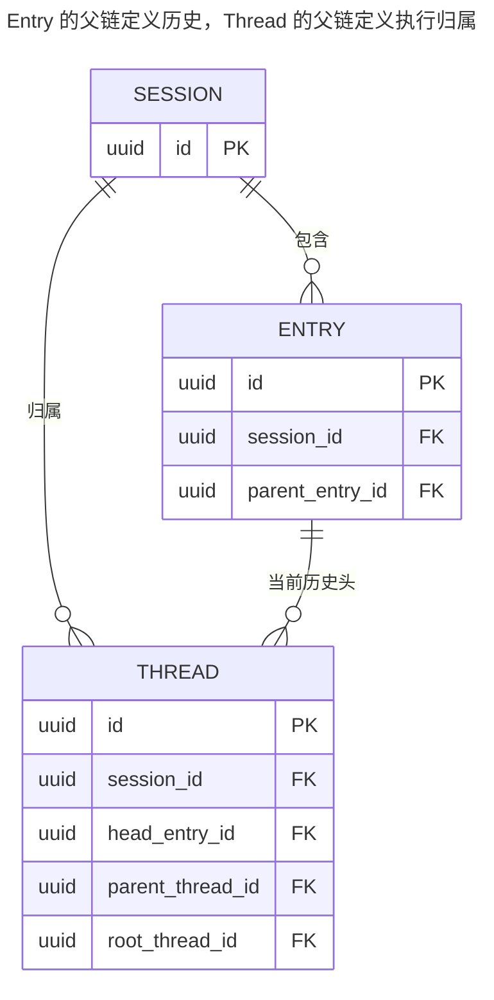
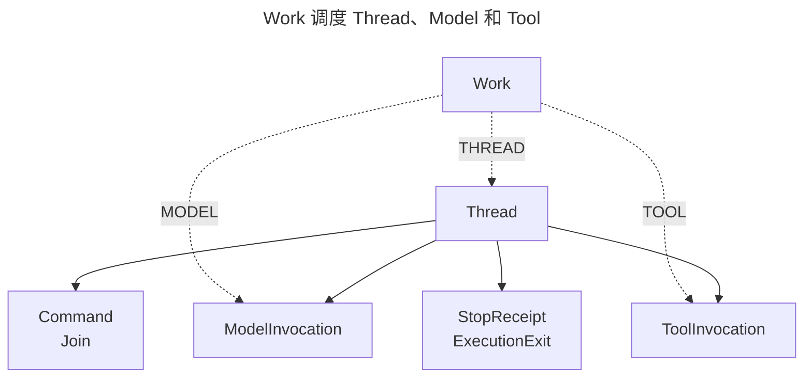
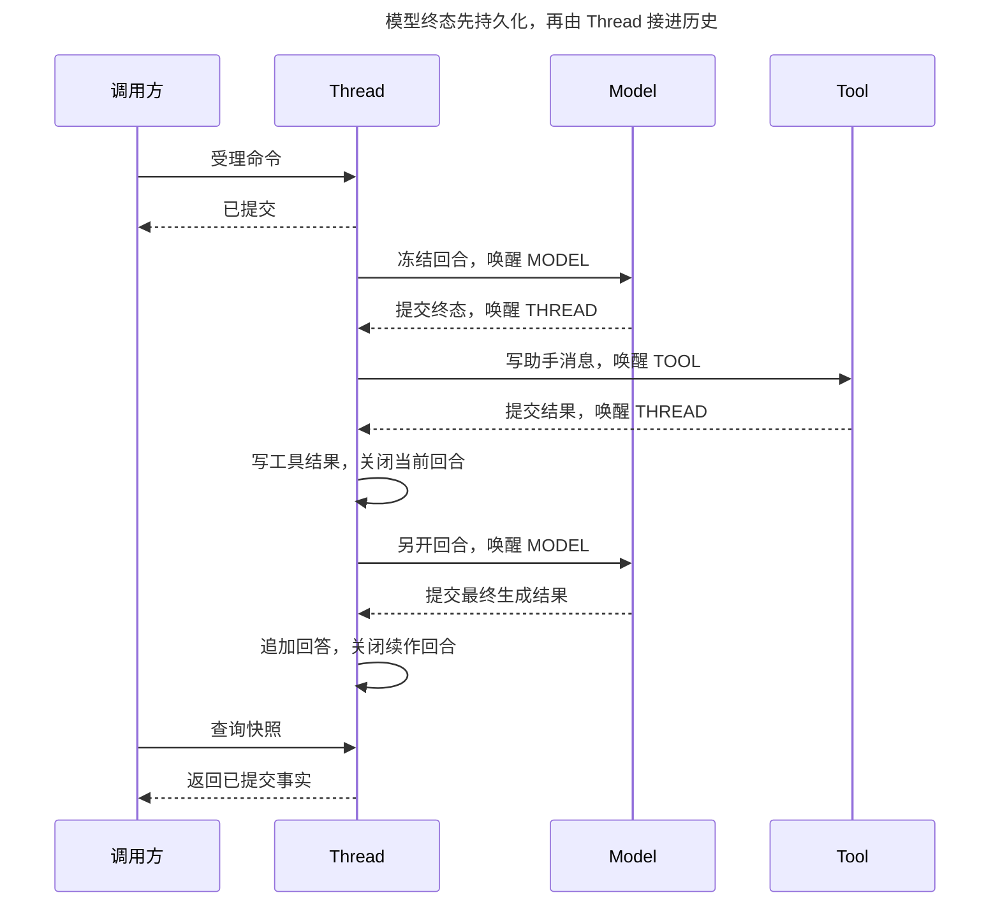

# Harness

**Harness 是 Agent 的持久化执行内核。** 输入登记为 Command。Worker 领取 Work，推进模型、工具和子 Agent。Entry 保存历史，Thread 指向执行进度，Invocation 保存调用状态，Work 记录调度时间与租约。进程重启后，Worker 从已提交的记录继续。

## 分层与依赖 {#boundaries}

```layers
---
title: 从外部请求到执行事实
---
- 接入 | 外部协议
  - Platform HTTP: 路由, 参数转换, 响应 DTO
  - WebSocket: 订阅, 快照推送
- 执行 | Harness Runtime
  - Java API: 命令与控制, 一致快照
  - Processor: Thread 推进, 工具执行
- 适配 | 驱动与基础设施
  - Builtin Driver: 回合解析, 模型调用
  - Platform Runtime: 事务存储, Work 分发, 执行网关
- 外部系统 | 持久化与执行
  - PostgreSQL {db}: 历史, 调度, 退出证据
  - 执行后端 {ext}: Model Provider, Environment Daemon
```

**Runtime 产出执行语义，接入层产出客户端响应。** HTTP 把请求转换成 Java 命令。创建 Session 时，应用服务负责归属与附件，调用 [`HarnessRuntime`](../harness/runtime/src/main/java/fun/fengwk/kkstudio/harness/runtime/HarnessRuntime.java) 在同一事务接受命令。读取 Thread 时，Runtime 从已提交事实派生 `ThreadSnapshot` 和运行状态；[平台读服务](../platform/runtime/src/main/java/fun/fengwk/kkstudio/platform/harness/http/HarnessThreadService.java#L50) 组装 DTO，补充费用及环境等待。HTTP 查询与 WebSocket 的 Thread 快照共用该服务。

| 模块 | 职责 |
| --- | --- |
| [Harness Runtime](modules/harness-runtime.md) | 接受执行命令，维护 Session、Entry、Thread、工具、委派和退出证据，提供一致快照。`api` 定义公共值，`spi` 定义端口，Processor 推进状态。 |
| [Harness Agent Builtin](modules/harness-agent-builtin.md) | 解析回合、冻结请求与工具绑定、执行 `MODEL` Work。通过 `AgentDriver` 把私有模型状态映射为公共 generation，把终态写成 Entry 或工具批次。 |
| [Harness Model](modules/harness-model.md) | 定义模型、请求、响应、SSE、用量和错误；适配 OpenAI Chat Completions、OpenAI Responses、Anthropic Messages 和 Google Gemini。 |
| [Harness Environment](modules/harness-environment.md) | 定义环境身份、能力、参数 schema、执行与重新挂接契约。 |
| [Platform Runtime](modules/platform.md#harness-持久化与调度) | 实现 PostgreSQL Store、目录解析、Work 分发、网关与通知。HTTP 适配器接入应用用例并组装响应。 |
| [Web](modules/web.md) | [装配](../web/src/main/java/fun/fengwk/kkstudio/web/runtime/HarnessRuntimeConfiguration.java) Runtime、Driver、Dispatcher 与执行生命周期，提供 WebSocket 传输。 |

`runtime` 依赖 `model` 和 `environment` 的契约，通过 `AgentDriver` 使用具体 Driver。`agent-builtin` 实现该接口。Platform 的目录适配器将 Agent 配置解析为 Builtin 请求；公共 Store 与 Builtin 专用 Store 共用一个 PostgreSQL 事务。

## 库表结构 {#model}

`PK` 表示主键，`FK` 表示外键，`?` 表示允许 `NULL`。`timestamptz(3)` 保存毫秒精度时间。

### 历史树与执行树



- **历史树**：同一个 Session 的 Thread 可以共享历史前缀。每条 Thread 的 `EntryPath` 从 `head_entry_id` 沿 `parent_entry_id` 回溯到 `ROOT`，再按正序读取。
- **执行树**：`parent_thread_id` 连接直接父 Thread，`root_thread_id` 定位整棵树。执行树用于委派、停止和删除，可包含多个 Session。子 Agent 通常拥有独立 Session，压缩子 Thread 与发起者共用 Session。

#### [`harness_session`](../schema/src/main/resources/db/migration/V1__schema.sql#L301)

| 字段 | 类型 | 含义 |
| --- | --- | --- |
| `id` | `uuid` · PK | Session 身份 |
| `name` | `varchar(256)` | 显示名称 |
| `created_at` | `timestamptz(3)` | 创建时间 |

#### [`harness_entry`](../schema/src/main/resources/db/migration/V1__schema.sql#L315)

| 字段 | 类型 | 含义 |
| --- | --- | --- |
| `id` | `uuid` · PK | 历史节点身份 |
| `session_id` | `uuid` · FK | 所属 Session |
| `parent_entry_id` | `uuid`? · FK | 同 Session 的父 Entry；`ROOT` 取 `NULL` |
| `entry_type` | `varchar(32)` | 节点类型 |
| `payload` | `jsonb` | [按类型编码的数据](#payloads) |
| `entry_seq` | `bigint` | 数据库分配的追加序号；用于 Session 历史分页 |
| `created_at` | `timestamptz(3)` | 创建时间 |

父节点用 `(session_id, parent_entry_id)` 引用同 Session 的 Entry。创建 Session 时写入 `ROOT`；部分唯一索引约束每个 Session 至多一个根节点。

#### [`harness_thread`](../schema/src/main/resources/db/migration/V1__schema.sql#L378)

| 字段 | 类型 | 含义 |
| --- | --- | --- |
| `id` | `uuid` · PK | 执行线身份 |
| `session_id` | `uuid` · FK | 历史所属 Session |
| `parent_thread_id` | `uuid`? · FK | 直接执行父节点；执行根取 `NULL` |
| `root_thread_id` | `uuid` · FK | 执行树根；执行根指向自身 |
| `head_entry_id` | `uuid` · FK | 当前历史头；与 `session_id` 组成复合外键 |
| `creation_request_hash` | `char(64)` | 创建请求指纹；用于精确重放 |
| `name` | `varchar(256)` | Thread 显示名称 |
| `kind` | `varchar(24)` | 创建时确定的执行类型 |
| `constraints` | `jsonb` | `{maxOutputTokens, allowAutoCompaction}` |
| `yolo_enabled` | `boolean` | 自动放行开关；权限判定使用执行根的值 |
| `execution_control` | `varchar(16)` | `RUNNABLE` / `STOPPED` |
| `input_through_sequence` | `bigint` | 已处理的普通输入水位，初始为 0 |
| `next_command_sequence` | `bigint` | 下一条命令的入队序号，从 1 开始 |
| `version` | `bigint` | 并发校验和失效通知游标 |
| `created_at` | `timestamptz(3)` | 创建时间 |
| `updated_at` | `timestamptz(3)` | 最近更新时间 |

`root_thread_id` 上的索引支持执行树查询。`(session_id, name)` 对执行根唯一，`input_through_sequence < next_command_sequence`。

`ThreadState` 对应 Thread 行。Session、父、根、类型、创建指纹和约束在创建时固定。`kind` 取 `USER`、`SUBAGENT` 或 `COMPACTION`。`maxOutputTokens` 可取 `null`；子 Thread 保存与父约束合并后的有效值，自身的 `yolo_enabled` 为 `false`。

### 命令、调用与调度



Runtime 注册 `THREAD` 和 `TOOL`，Builtin Driver 注册 `MODEL`。实线连接 Thread 的业务记录，虚线指向各 Work 类型的调度目标。

#### [`harness_thread_command`](../schema/src/main/resources/db/migration/V1__schema.sql#L485)

| 字段 | 类型 | 含义 |
| --- | --- | --- |
| `thread_id` | `uuid` · PK · FK | 目标 Thread |
| `sequence` | `bigint` · PK | Thread 内命令序号 |
| `command_type` | `varchar(32)` | 命令类型 |
| `payload` | `jsonb` | 按命令类型编码的输入 |
| `idempotency_key` | `uuid` | 调用方提交的幂等键 |
| `request_hash` | `char(64)` | 用于核对重放内容的请求指纹 |
| `applied_entry_id` | `uuid`? · FK | 应用命令时写入的 Entry |
| `stop_request_id` | `uuid`? | 撤销命令的 Stop 请求 |
| `cancelled_at` | `timestamptz(3)`? | 撤销时间 |
| `created_at` | `timestamptz(3)` | 接受时间 |

复合主键为 `(thread_id, sequence)`；`(thread_id, idempotency_key)` 唯一。索引支持按序读取排队命令、按 Stop 请求查询撤销的命令。

#### [`builtin_model_invocation`](../schema/src/main/resources/db/migration/V1__schema.sql#L1218)

| 字段 | 类型 | 含义 |
| --- | --- | --- |
| `id` | `uuid` · PK | 一次逻辑 generation 的身份 |
| `thread_id` | `uuid` · FK | 所属 Thread |
| `turn_start_entry_id` | `uuid` · FK | 所属回合的起点 |
| `request_head_entry_id` | `uuid` · FK | 请求采用的历史头 |
| `request_spec` | `jsonb` | 冻结的模型请求规格 |
| `status` | `varchar(16)` | 模型调用状态 |
| `attempt` | `integer` | 本次调用已启动的尝试次数 |
| `stream_checkpoint` | `jsonb`? | 当前 attempt 的累计输出 |
| `result` | `jsonb`? | 成功结果 |
| `error` | `jsonb`? | 终态错误 |
| `result_entry_id` | `uuid`? · FK | 结果物化后的历史坐标 |
| `failed_attempts` | `jsonb` | 已记录的失败尝试 |
| `group_execution` | `jsonb`? | 模型组成员与重试游标 |
| `requested_at` | `timestamptz(3)`? | 本次尝试的请求时间 |
| `created_at` | `timestamptz(3)` | 创建时间 |
| `updated_at` | `timestamptz(3)` | 最近更新时间 |

Builtin Driver 持有此表。`(thread_id, turn_start_entry_id)` 唯一，每个已挂接的 `result_entry_id` 唯一。结果物化后清理行；进入工具阶段时保留到批次应用完成。

#### [`harness_tool_invocation`](../schema/src/main/resources/db/migration/V1__schema.sql#L545)

| 字段 | 类型 | 含义 |
| --- | --- | --- |
| `id` | `uuid` · PK | 工具调用身份 |
| `thread_id` | `uuid` · FK | 所属 Thread |
| `turn_start_entry_id` | `uuid` · FK | 所属回合的起点 |
| `assistant_entry_id` | `uuid` · FK | 声明调用的 Assistant Entry |
| `call_index` | `integer` | 在 Assistant 消息中的调用位置，从 0 开始 |
| `call` | `jsonb` | 调用 ID、工具名和参数 |
| `binding` | `jsonb`? | 冻结的工具定义与路由 |
| `status` | `varchar(32)` | 工具调用状态 |
| `attempt` | `integer` | 本次调用已启动的尝试次数 |
| `approval` | `jsonb`? | 审批记录 |
| `result` | `jsonb`? | 工具返回结果 |
| `error` | `jsonb`? | 终态错误 |
| `input_receipt` | `jsonb`? | 人工回答或拒答的回执 |
| `created_at` | `timestamptz(3)` | 创建时间 |
| `updated_at` | `timestamptz(3)` | 最近更新时间 |

`(assistant_entry_id, call_index)` 唯一；同一 Assistant 的调用按顺序形成批次。批次结果写进 Entry 后删除调用行。`WAITING_CHILD` 纳入状态约束与非终态索引；人工待办索引覆盖 `WAITING_APPROVAL` 和 `WAITING_INPUT`。

#### [`durable_work`](../schema/src/main/resources/db/migration/V1__schema.sql#L617)

| 字段 | 类型 | 含义 |
| --- | --- | --- |
| `target_type` | `varchar(16)` · PK | 调度目标类型 |
| `target_id` | `uuid` · PK | 目标身份，按 `target_type` 解释 |
| `available_at` | `timestamptz(3)` | 最早领取时间 |
| `wake_version` | `bigint` | 累计唤醒游标 |
| `lease_token` | `uuid`? | 当前认领 token |
| `lease_until` | `timestamptz(3)`? | 当前租约截止时间 |
| `required_environment_id` | `uuid`? · FK | 调用要求的 Environment |

复合主键为 `(target_type, target_id)`。`lease_token` 与 `lease_until` 成对填写。环境亲和用于 TOOL；持有该环境就绪连接租约的节点可领取对应 Work。

### 交付、停止与桥接记录

#### [`harness_thread_join`](../schema/src/main/resources/db/migration/V1__schema.sql#L655)

| 字段 | 类型 | 含义 |
| --- | --- | --- |
| `invocation_id` | `uuid` · PK | 委派或任务票据身份 |
| `request_hash` | `char(64)` | 委派请求指纹 |
| `parent_thread_id` | `uuid`? · FK | 接收结果的父 Thread；独立任务取 `NULL` |
| `child_thread_id` | `uuid` · FK | 执行任务的 Thread |
| `source_command_sequence` | `bigint` · FK | 子 Thread 接受的源命令序号 |
| `agent` | `varchar(256)` | 本次委派使用的 Agent |
| `delivery` | `varchar(32)` | [结果交付方式](#subexecution) |
| `superseded_by_invocation_id` | `uuid`? · FK | 接替本次委派的新票据 |
| `max_turns` | `integer`? | 轮数软预算 |
| `reminder_turn` | `bigint` | 已发出的预算提醒计数 |
| `terminal_entry_id` | `uuid`? · FK | 已结算的终态边界 |
| `final_answer_entry_id` | `uuid`? · FK | 本次委派的最终回答 |
| `delivery_command_sequence` | `bigint`? · FK | 发往父 Thread 的通知命令序号 |
| `created_at` | `timestamptz(3)` | 接受时间 |
| `updated_at` | `timestamptz(3)` | 最近更新时间 |

源命令和通知命令分别以子、父的 `(thread_id, sequence)` 引用 Command。回执从固定的源命令、终态与回答坐标重建。

#### [`harness_thread_stop_receipt`](../schema/src/main/resources/db/migration/V1__schema.sql#L728)

| 字段 | 类型 | 含义 |
| --- | --- | --- |
| `thread_id` | `uuid` · PK · FK | 被停止的 Thread |
| `stop_request_id` | `uuid` · PK | 该 Thread 的停止请求 ID |
| `root_stop_request_id` | `uuid` | 整批 Stop 的请求 ID |
| `stopped_turn_end_entry_id` | `uuid`? · FK | 本次停止写入的回合结束坐标 |
| `created_at` | `timestamptz(3)` | 停止回执的创建时间 |

复合主键为 `(thread_id, stop_request_id)`。按 `root_stop_request_id` 汇总原始停止集合，按 Command 表的 `stop_request_id` 查撤销的输入。

#### [`harness_execution_exit`](../schema/src/main/resources/db/migration/V1__schema.sql#L753)

| 字段 | 类型 | 含义 |
| --- | --- | --- |
| `execution_id` | `uuid` · PK | 一次实际执行的身份 |
| `thread_id` | `uuid` · FK | 所属 Thread |
| `invocation_id` | `uuid` | 对应的逻辑模型或工具调用 |
| `attempt` | `integer` | 此执行所属的尝试代次 |
| `owner_lease_token` | `uuid` | 执行登记时的 Work 租约 token |
| `kind` | `varchar(16)` | `DRIVER` / `TOOL` / `REMOTE` |
| `parent_execution_id` | `uuid`? · FK | 远端代次所关联的本地执行 |
| `environment_id` | `uuid`? | 远端执行环境 |
| `state` | `varchar(32)` | [退出证据状态](#stop) |
| `registered_at` | `timestamptz(3)` | 登记时间 |
| `confirmed_at` | `timestamptz(3)`? | 确认退出时间 |
| `abandoned_at` | `timestamptz(3)`? | 人工放弃确认的时间 |

退出记录按 Thread 查询，并独立于 Invocation 行保留。远端记录关联 Environment 和发起它的本地执行。

#### [`session_blob_ref`](../schema/src/main/resources/db/migration/V1__schema.sql#L823)

| 字段 | 类型 | 含义 |
| --- | --- | --- |
| `session_id` | `uuid` · PK · FK | 持有 Blob 的 Session |
| `blob_id` | `uuid` · PK · FK | 存储 Blob |
| `created_at` | `timestamptz(3)` | 建立引用的时间 |

复合主键为 `(session_id, blob_id)`；两个外键限制被引用行的删除。同一 Session 对同一 Blob 建立一条持有边；复制到新 Session 时为目标登记持有边。

#### [`realtime_subscription`](../schema/src/main/resources/db/migration/V1__schema.sql#L466)

| 字段 | 类型 | 含义 |
| --- | --- | --- |
| `thread_id` | `uuid` · PK · FK | 被订阅的 Thread |
| `node_instance_id` | `uuid` · PK | 订阅节点实例 |
| `lease_until` | `timestamptz(3)` | 订阅租约截止时间 |

复合主键为 `(thread_id, node_instance_id)`。节点续租记录其订阅范围，删除 Thread 时级联清理。

SQL 校验引用、唯一性、枚举和 JSON 容器，Java 值类型与 codec 校验 payload。工具批次在应用层核对 `call_index` 连续、与 Assistant 声明一一对应、归属于同一个开放回合。

## 模型与字段 {#payloads}

### Entry 和回合文法

`Entry` 的公共模型是 `{id, sessionId, parentEntryId, payload, createdAt}`。`entry_type` 选择 payload 的编码，`entry_seq` 用于存储层追加排序。`TURN_START` 打开回合，匹配的 `TURN_END.turnStartEntryId` 关闭它；开放回合的路径前缀是恢复入口。

| `entry_type` | 持久化 payload 字段 | 语义 |
| --- | --- | --- |
| `ROOT` | `settings` | 初始 `BranchSettings`。 |
| `SYSTEM` | `sections`、`removedSections`、`addedTools`、`removedTools`、`addedHostedTools`、`removedHostedTools`、`baseline` | 具名系统提示词和模型可见工具的基线/变更，在使用它的回合之前写入。 |
| `TURN_START` | `reason`、`settings`、`ownerThreadId`、`contextWindow`、`maxOutputTokens`、`compaction`、`executedSelection`、`capabilities` | 冻结本轮的归属、预算、实际执行选择和能力；未解析预算时两个预算字段都为空。 |
| `MESSAGE` | `message`、`assistantMetadata`、`toolResultMetadata` | `message` 为 `{role, contents}`，角色为 `USER`、`ASSISTANT`、`TOOL`；后两者各有相应 metadata，用户消息均无。 |
| `CUSTOM_MESSAGE` | `contributorId`、`customType`、`rendererKey`、`message`、`details` | 可信调用方的类型化输入。 |
| `NOTIFICATION` | `notificationId`、`kind`、`sourceThreadId`、`message` | 运行时通知，例如子结果或软预算提醒；可进入模型上下文。 |
| `MODEL_ATTEMPT_FAILURE` | `attempt`、`model`、`requestedAt`、`error`、`retryAt` | 记录一次失败尝试及下一次重试时间。 |
| `ASSISTANT_ERROR` | `error`、`attempt` | 确定性失败或取消屏障，可带最后一次 attempt 的输出快照。 |
| `ASSISTANT_ABORTED` | `message` | 中止时保存的 Assistant 输出。 |
| `COMPACTION` | `summaryText`、`assistantMetadata` | 压缩回合得到的非空摘要。 |
| `NATIVE_COMPACTION` | `trigger`、`preTokens`、`postTokens`、`cumulativeDroppedTokens`、`durationMs`、`nativeHeadId`、`nativeAnchorId`、`nativeTailId` | 执行后端的原生压缩审计；保留后端原生标识。 |
| `SETTINGS` | `settings`、`ownerThreadId` | 在回合间记录生效的设置。 |
| `FORK` | `mode`、`sourceEntryId`、`sourceThreadId` | 记录新分支或复制的来源切点。 |
| `TURN_END` | `turnStartEntryId`、`outcome`、`continueModel`、`reason`、`closeRequestId` | 关闭同一回合。`continueModel=true` 仅允许 `COMPLETED`；`STOPPED` 必须带 `USER_STOP` 与停止请求 ID。 |

回合原因有 `INPUT`、`CONTINUATION`、`COMPACTION`、`COMPACTION_BRANCH_INPUT`、`COMPACTION_BRANCH_CONTINUATION` 和 `STOP`。一条路径同一时刻最多一个开放回合，普通回合最多一个 Assistant 结果。工具结果归属同一回合，并按 Assistant 的声明顺序写入。`SYSTEM`、`SETTINGS`、`FORK` 和 `NATIVE_COMPACTION` 位于回合之间。回合文法和完整 JSON 契约分别由 [TurnPathValidator](../harness/runtime/src/main/java/fun/fengwk/kkstudio/harness/api/history/TurnPathValidator.java) 和 [Entry payload codec](../harness/runtime/src/main/java/fun/fengwk/kkstudio/harness/codec/HistoryEntryPayloadJsonCodec.java) 维护。

- **设置**：`BranchSettings` 是 `{agentName, execution, environmentName}`；`execution` 是 `{driver, settings}`，Builtin 的 `settings` 包含 `modelName` 与 `variant`，`variant=null` 表示未指定。Driver 在 Thread 创建时固定。子回合规划时读取执行根已生效的环境；已启动的请求使用其冻结规格。YOLO 保存在 Thread 的运行控制字段。
- **能力**：`capabilities` 冻结 `subagentBindings` 和 `mediaCapabilities`；`compaction` 在压缩回合保存 `trigger`、`execution`、`outputBudget`、`cutEntryId`、`childThreadId`、`joinInvocationId`。`executedSelection` 记录实际采用的执行配置覆盖项。
- **消息**：`contents` 是有序的带 `type` 的内容块，包括 `text`、`thinking`、`redacted_thinking`、`json`、`tool_call`、`tool_result`、`resource`。接受阶段将上传 ID 解析成持久 Resource，历史保存该引用。Tool 结果 metadata 记录 `assistantEntryId`、`toolCallId`、`callIndex`、`status`、`synthetic`、`reason`、`inputReceipt`、`invocationId`、`toolName`，用于调用行删除后的回溯和重放核对。

### Command、Invocation 与模型配置

#### Command

| 类型 | `payload` 字段 |
| --- | --- |
| `USER_MESSAGE`、`CUSTOM_MESSAGE` | `message` |
| `NOTIFICATION` | `notificationId`、`kind`、`sourceThreadId`、`message` |
| `SET_EXECUTION` | `execution` |
| `SET_ENVIRONMENT` | `environmentName` |

命令状态由应用和取消标记派生：标记均为空时为 `QUEUED`；记录 `applied_entry_id` 后为 `APPLIED`；填齐 `stop_request_id` 和 `cancelled_at` 后为 `CANCELLED`。`ThreadCommand` 校验应用和取消标记互斥；[命令 codec](../harness/runtime/src/main/java/fun/fengwk/kkstudio/harness/codec/ThreadCommandPayloadJsonCodec.java) 负责 payload 编码。

#### ModelInvocation

| JSON 列 | 保存内容 |
| --- | --- |
| [`request_spec`](../harness/agent-builtin/src/main/java/fun/fengwk/kkstudio/harness/builtin/port/store/ModelRequestSpecJsonCodec.java) | `providerType`、`model`、`variant`、`outputTokens`、`systemInstruction`、`systemSections`、`toolBindings`、`subagentBindings`、可选 `groupExecution` |
| `stream_checkpoint` | `attempt`、`sequence`、累计 `text` 和 `thinking` |
| `failed_attempts` | 失败尝试、最后的输出进度、模型、错误、时间和重试时间 |
| `group_execution` | `groupName`、`groupVersion`、`memberIndex`、`memberAttempts` |

Builtin 将冻结规格与 `request_head_entry_id` 对应的历史组装成中立 `ProviderRequest`。上游协议适配器编码 SYSTEM、消息和工具结果；平台网关解析端点和凭据。重试沿用冻结规格，新回合重新解析目录。

#### ToolInvocation

| JSON 列 | 保存内容 |
| --- | --- |
| `call` | 调用 ID、工具名、参数 |
| [`binding`](../harness/runtime/src/main/java/fun/fengwk/kkstudio/harness/codec/ToolBindingJsonCodec.java) | `definition`、`contributor`、`environmentSupport`、`environmentId`、`environmentName`、`configuredSkills` |
| `approval` | 决策、决策 ID、操作者、原因、时间、可选编辑审查 |
| `input_receipt` | `submissionId`、`actor`、`acceptedAt` |
| `result` / `error` | 互斥的终态字段；`result` 可携带工具返回的业务错误标记 |

#### 模型目录与运行时选择

[目录表](../schema/src/main/resources/db/migration/V1__schema.sql#L846) 以逻辑名标识 Agent、Provider 和模型。`model.kind=MODEL` 通过 `provider_name` 关联 Provider，用 `model_id` 向上游请求；`kind=GROUP` 保存有序成员与降级、冷却设置。`model_group_cooldown` 的冷却记录按组、成员、variant 和组配置版本生效。

| 模型 | 字段 | 含义 |
| --- | --- | --- |
| [ModelDescriptor](../harness/model/src/main/java/fun/fengwk/kkstudio/harness/model/ModelDescriptor.java) | `providerName`、`modelName`、`modelId` | 目录与上游标识 |
| ModelDescriptor | `inputModalities`、`tools`、`reasoning` | 模型输入与生成能力 |
| ModelDescriptor | `midConversationSystemMessages`、`messageLevelEffort` | 协议能力 |
| [ModelVariant](../harness/model/src/main/java/fun/fengwk/kkstudio/harness/model/ModelVariant.java) | `id`、`reasoningEffort` | 变体身份与推理强度；`off` 表示显式关闭 |
| ModelVariant | `promptCacheRetention`、`protocolOptions` | 缓存时长档位与上游协议选项 |

模型回合冻结输出预算。读服务用历史用量和查询时的目录费率计算费用。

## 一条输入怎样执行完 {#flow}

新 Session 收到一条输入。模型先请求工具，再根据工具结果给出最终答复。`S`、`T`、`M1`、`I1` 和 `E0` 等代称分别代表本次执行中的 UUID。



### 接受命令：创建 Session 并入队

`acceptCommands` 在一个事务中创建 `Session S`、`ROOT E0`、`Thread T`（`main`，head=`E0`）；插入 `Command (T, 1)`，把 `next_command_sequence` 从 1 推到 2，登记 `Work (THREAD, T)`。此时输入水位为 0，用户消息保存在 `QUEUED` Command 中。归属、附件、命令和唤醒可在同一物理事务提交或回滚。

既有 Thread 在执行树锁内向队列尾部分配序号并唤醒。单条纯用户消息省略游标，可在运行中排队；其它批次同时匹配 `expectedHeadEntryId` 与 `expectedNextCommandSequence`。Runtime 先核对幂等键、请求内容及批次顺序，精确重放返回原回执与序号，其余复用请求返回冲突。新建身份还以 `threadId` 和 `creation_request_hash` 核对重放。实现入口：[AcceptCommandsControl](../harness/runtime/src/main/java/fun/fengwk/kkstudio/harness/runtime/AcceptCommandsControl.java#L52)。

### THREAD 规划：应用命令、冻结请求、登记 MODEL Work

Dispatcher 先用独立短事务领取 Work。`ThreadProcessor` 入场做 Work 所有权预检，再开启主事务。它在执行树锁下读取并锁定当前 Thread 与必要的直接父 Thread、Session，加载当前历史和排队命令。每次领取处理一个动作：开回合、应用结果、补派工具、继续下一回合，或结束本次唤醒。

此处是 `INPUT`：`TurnPlanBuilder` 在内存构造候选路径，Driver 同步解析；解析成功后，**同一短事务**里写 `SYSTEM E1`（需要时）、`TURN_START E2`、用户 `MESSAGE E3`，把 `(T, 1).applied_entry_id` 指向 `E3`，更新 `T.head=E3` 和输入水位 `1`。Builtin `Accepted.install` 新建 `M1(READY, attempt=0, requestHead=E3, turnStart=E2)` 并请求 `(MODEL, M1)`。同一事务完成 THREAD claim；失权则整笔回滚。设置命令在回合边界归约为 `SETTINGS` 并标记已应用；模型调用由输入或续作触发。

实现入口：[ThreadProcessor](../harness/runtime/src/main/java/fun/fengwk/kkstudio/harness/runtime/processor/ThreadProcessor.java#L152)、[TurnCommitter](../harness/runtime/src/main/java/fun/fengwk/kkstudio/harness/runtime/processor/TurnCommitter.java#L53)、[BuiltinAcceptedTurn](../harness/agent-builtin/src/main/java/fun/fengwk/kkstudio/harness/builtin/driver/BuiltinAcceptedTurn.java#L79)。

### MODEL 执行：先记「开始」，再出事务调用 Provider

`ModelProcessor` 短事务读取并核对 Thread、`M1` 与 claim。请求物化和网关准入发生在执行阶段；`Busy` 重排 MODEL Work，`Rejected` 写入失败结果。准入通过后，启动短事务把 `M1` 变为 `RUNNING, attempt=1`，登记具体本地执行的退出事实；完成登记才允许发出请求。Provider I/O 在事务外阻塞执行，期间心跳续租，流式输出按节奏写 checkpoint；增量事件可丢，已写入的 checkpoint 可重读。

Provider 完成时，另一个短事务核对有效 claim 与当前 attempt，提交 `M1` 的结果和终态，推进 `T.version`，请求 `(THREAD, T)` 并收尾 MODEL Work。**MODEL 事务保存调用终态，下一笔 THREAD 事务追加 Assistant Entry。** 在两者之间重启时，Worker 领取 THREAD Work，读取终态并写入历史。实现入口：[ModelExecutionLauncher](../harness/agent-builtin/src/main/java/fun/fengwk/kkstudio/harness/builtin/processor/ModelExecutionLauncher.java)、[ModelTerminalCommitter](../harness/agent-builtin/src/main/java/fun/fengwk/kkstudio/harness/builtin/processor/ModelTerminalCommitter.java)。

### THREAD 物化模型结果：生成工具批次

`ThreadProcessor` 看到 Driver 响应待应用，在短事务中让 Driver 追加此前的失败 attempt 审计（如有）和助手 `MESSAGE E4`，把 head 推到 `E4`。这一消息声明了工具调用，因此创建 `ToolInvocation I1`，引用 `T/E2/E4`，`call_index=0`，初始可执行状态为 `READY`；登记 TOOL Work，回合保持开放。同一 Assistant 的调用构成一个批次；相互独立的调用并行，同环境同文件的写改调用按键排队。模型直接给出最终答复时，本事务追加 `TURN_END` 并收尾。

### TOOL 执行：工具结果先落调用行

TOOL Worker 领取 `(TOOL, I1)`。许可检查和网关准入通过后，短事务先写 `RUNNING, attempt=1` 与退出事实；实际工具在事务外执行。成功结果在另一个短事务写入 `I1.result`、置为 `SUCCEEDED`，请求 `(THREAD, T)` 并完成 TOOL claim。这时 `T.head` 仍可以是 `E4`；退出证明与逻辑结果是各自独立的事实。审批、问卷和子任务在[对应等待状态](#recovery)持久化，条件满足后唤醒。

### THREAD 应用全批：关闭第一个回合，另开回合

全部工具都到终态后，Thread 按 `call_index` 追加工具结果（示例为 `MESSAGE E5`），再追加 `E6 = TURN_END(COMPLETED, continueModel=true)`；在同一事务推进 head、清理本批 Tool 行和 Builtin generation，重新请求 THREAD Work。`COMPLETED` 是该回合的结果。各工具的结果单独保存在 `MESSAGE(TOOL)`，`continueModel=true` 登记下一回合的继续义务。

Thread 在回合边界先判断压缩和新输入，再处理续作。直接续作时，下一笔 THREAD 事务写 `E7 = TURN_START(CONTINUATION)`，创建 `M2`，用包含 `E5` 的历史组装模型请求。模型给出最终答案后，THREAD 追加 `E8 = MESSAGE(ASSISTANT)` 与 `E9 = TURN_END(COMPLETED, continueModel=false)`。待执行义务全部结清后，快照显示 `IDLE`。模型结果与工具批次的两类物化都在 [ThreadProcessor](../harness/runtime/src/main/java/fun/fengwk/kkstudio/harness/runtime/processor/ThreadProcessor.java#L367)。

```text
E0 ROOT → E1 SYSTEM → E2 TURN_START(INPUT) → E3 USER
→ E4 ASSISTANT（tool call） → E5 TOOL → E6 TURN_END(continue=true)
→ E7 TURN_START(CONTINUATION) → E8 ASSISTANT → E9 TURN_END
```

从任意已提交断点判断下一步：`Command=QUEUED` 看 THREAD；`M1=READY/RUNNING` 看 MODEL；`M1` 终态且尚无结果 Entry 看 THREAD；`I1` 等待看相应触发条件；全批已终止看 THREAD；`TURN_END.continueModel=true` 看下一轮规划。每次推进用该阶段的记录恢复。

## Work、并发与失败恢复 {#recovery}

### Work 的两个围栏

`lease_token` 与 `lease_until` 确定当前所有者和写入期限，`wake_version` 记录处理期间的新唤醒。领取和续租以 PostgreSQL 时间为准；业务事务的 `tx.now()` 取值后在事务内固定。

| 操作 | 对 Work 行的作用 |
| --- | --- |
| `request` | 新行 `wake_version=1`；已有行版本 +1、到期时间取更早值，保留已有租约字段。同一目标的唤醒合并到该行。 |
| `claim` | SQL 按已到期、无有效租约、环境路由匹配挑选，`FOR UPDATE SKIP LOCKED`；写入新 token 和租约时间，返回认领时的 wake version。 |
| `renew` | 核对 token 与租约有效期，延长有效租约。 |
| `complete` | 同一个有效 claim，且 wake version 未变才删行；中间有新 wake 时只清租约，保留行。 |
| `reschedule` / `release` | 清租约。重排在版本未变时设新到期时间，有新 wake 时保留更早值；释放时将到期时间向现在提前。两种操作均校验有效租约。 |

例：Worker A 拿到版本 7；另一事务又请求处理，行变成 8，仍由 A 持有租约。A 校验当前执行后可以提交；`complete(7)` 清租约，并保留版本 8 供下次领取。若 A 的租约先过期，B 用新 token 接手，数据库校验拒绝 A 的迟到写回。

[DurableWorkStore](../work/src/main/java/fun/fengwk/kkstudio/work/DurableWorkStore.java) 是 Work 的 SQL 实现；[Dispatcher](../platform/runtime/src/main/java/fun/fengwk/kkstudio/platform/harness/dispatch/HarnessWorkDispatcher.java) 按类型分发。异常退出时保留 lease，过期后由扫描重新领取。`LISTEN/NOTIFY` 触发即时扫描，周期扫描覆盖未来到期与遗漏唤醒。Worker 的短事务先锁所属业务行，再核对并锁住 claim；某些 THREAD 步骤先写低锁级事实、最后验证 claim，验证失败会回滚全部未提交写入。

### 事务与锁的边界

[PostgreSQL Store](../platform/runtime/src/main/java/fun/fengwk/kkstudio/platform/harness/store/PostgresqlHarnessStore.java) 使用 `READ_COMMITTED`，加入外层事务时共用同一连接；Driver Store 参与同一事务。事务句柄在创建它的线程和回调内有效。Provider 请求、工具执行及人工等待在事务外进行；取消等进程内动作在物理提交后触发。

```text
Join 准入（需要时）→ 执行树（按根排序）→ Session → Thread
→ Command → Driver 私有行 → Tool → Work
```

树锁是结构写入和跨 Thread 交付的围栏。相同锁阶内，Thread 按 UUID、单 Thread 的 Command 按序号、同批 Tool 按 `call_index`、Work 按类型 rank 与目标 ID 等规则取锁。持有树锁和 Thread 锁时，父通知命令及 THREAD Work 按 [PostgresqlHarnessLocks](../platform/runtime/src/main/java/fun/fengwk/kkstudio/platform/harness/store/PostgresqlHarnessLocks.java) 的专用规则取锁。模型和工具在短事务内锁自己的 Thread、调用和 Work；审批和回答锁目标 Thread 与相关调用。Dispatcher 的 claim 和 heartbeat 仅取 Work 锁。Store 在每次回调内独立跟踪锁序。

### 等待哪个事实，恢复就读哪个事实

| 断点 | 恢复或拒绝的依据 |
| --- | --- |
| **解析回合失败** | 明确的 `TurnResolveTransientException` 回滚整个候选计划，并按延迟重排仍持有的 THREAD Work。确定性拒绝、解析异常和 Driver 契约违规补写 `ASSISTANT_ERROR` 与 `TURN_END(FAILED)`。 |
| **模型事务外执行失败** | 结果、失败 attempt、下次到期时间由重试策略约束。获准时追加审计、改回 `READY`、重排同一 MODEL Work，下一次登记新的 attempt；不可重试或预算耗尽时提交终态。模型组可按冻结成员顺序降级；冷却按组配置版本隔离。 |
| **模型 `RUNNING` 租约过期** | 按失败策略开启新 attempt 或提交终态。写入校验当前 token 和 attempt；流式恢复读取 checkpoint。 |
| **工具明确失败或失联** | 已知 `retryable` 且工具声明 `READ_ONLY` / `IDEMPOTENT` 才能按策略重试。接手 `RUNNING` 工具时，有精确远端身份就挂接原调用；恢复失败收敛为 `UNKNOWN`。task 已有 Join 时，从票据恢复。 |
| **等待审批** | `WAITING_APPROVAL` 是已冻结的工具请求。允许回 `READY` 并请求 TOOL Work，拒绝变为 `FAILED` 并唤醒 THREAD。`decisionId` 用于幂等。进入 `WAITING_APPROVAL` 后由审批决定后续动作。 |
| **等待问卷** | `ask_user` 冻结问卷并进入 `WAITING_INPUT`。回答或拒答写工具结果及 `submissionId` 回执，唤醒 THREAD；物化后可从历史核对精确重放。Stop 后的迟到回答或同键异内容拒绝。 |
| **等待环境** | `READY` 调用的 TOOL Work 带 `required_environment_id` 时，等待具备该环境就绪租约的节点领取。读服务用 Work 与环境租约派生等待状态；必需环境未绑定时，工具返回明确的未执行结果。 |
| **等待子任务** | 同步 task 持久化为 `WAITING_CHILD`，释放 TOOL 租约；Join 结算后唤醒父 TOOL Work，从固定回执形成结果。 |

模型生命周期为 `READY / RUNNING / SUCCEEDED / FAILED / CANCELLED / UNKNOWN`；工具在这些状态之外增加 `WAITING_APPROVAL / WAITING_INPUT / WAITING_CHILD`。`UNKNOWN` 结束逻辑调用，记录操作结果不明；外部副作用可能已经发生。退出账本独立记录执行状态，未确认退出仍阻塞收敛。重试策略和流式 checkpoint 详见 [Builtin Driver](modules/harness-agent-builtin.md#model-work-与流式执行)，工具执行入口是 [ToolProcessor](../harness/runtime/src/main/java/fun/fengwk/kkstudio/harness/runtime/processor/ToolProcessor.java)。

## 委派、分支与压缩 {#subexecution}

### Join：一次委派的可恢复回执

`spawn` 用 `invocation_id` 与请求指纹做精确重放。**接受源 prompt、创建或续用子 Thread、写入 Join 和登记 Work 一起提交。** 同一父子对至多一个有效未完成 Join；续接可按规则取代旧 Join，保留旧票据和源命令。额度从未完成票据推导；`max_turns` 触发轮数预算提醒。

普通结算要求源命令已应用、本地流程和输入已处理、直接子 Join 已结算、已登记的执行退出已收敛。符合收敛条件的 Stop 也可结算应用前被取消的源命令。`terminal_entry_id` 固定终态边界；`COMPLETED` 且 `continueModel=false` 的回合以 Assistant 消息收尾时，保存 `final_answer_entry_id`。历史回执使用这些固定坐标；最后一条退出确认到达时可在确认事务内补做结算。

| `delivery` | 结算时怎样交付 |
| --- | --- |
| `NOTIFY_PARENT` | 同事务冻结结果、插入父 `NOTIFICATION` Command、登记其序号；父为 `RUNNABLE` 时唤醒 THREAD，父为 `STOPPED` 时直接将通知写入历史并保留停止控制。 |
| `SETTLE_TOOL_RESULT` | 冻结回执后唤醒父 TOOL，由原 task Invocation 从回执形成工具结果。 |
| `SETTLE_OWNER_TURN` | 唤醒属于父 Thread 的开放回合，例如对齐压缩票据后写回摘要。对于 `STOPPED` 的父 Thread，匹配的显式维护压缩结算后继续保持 `STOPPED`。 |
| `RECEIPT_ONLY` | 独立任务保存回执，供调用方查询。 |

实现见 [AgentSpawner](../harness/runtime/src/main/java/fun/fengwk/kkstudio/harness/runtime/AgentSpawner.java) 和 [ThreadLifecycleCoordinator](../harness/runtime/src/main/java/fun/fengwk/kkstudio/harness/runtime/ThreadLifecycleCoordinator.java#L116)。

### 分支与历史复制

- **同 Session 分支**：从合法切点追加 `FORK`，新 Thread 以这条 `FORK` 为 head 成为独立执行根，共享切点以前的历史前缀。
- **跨 Session 复制**：验证切点在源执行根当前路径上，复制截止到该切点的有效上下文，产生新 Entry ID、重写内部坐标，并保留完整的有效压缩回合及所需 Blob 引用。目标 Session 从独立的执行状态开始。分支和复制的创建批次都以一条任务输入结尾。

### 压缩

父 Thread 打开 `TURN_START(COMPACTION)`，在同 Session 的切点创建内部 `COMPACTION` Thread、摘要输入与 `SETTLE_OWNER_TURN` Join。子 Thread 发起专用摘要请求，平台工具集为空。父 Thread 结算时追加 `COMPACTION` 摘要与 `TURN_END`。后续模型请求用摘要代替切点前的历史，并回放保留段；Entry 树保留原历史。

触发包括预算预判、Provider 上下文溢出、工具在安全边界请求，以及显式 `compactThread`。自动压缩保留继续义务；前次完成压缩后，下一次自动压缩要求期间已有成功的普通模型回合。显式维护压缩保存摘要后结束本轮工作。详见 [压缩规则](modules/harness-runtime.md#压缩) 与 [历史复制](../harness/runtime/src/main/java/fun/fengwk/kkstudio/harness/runtime/SessionForkCopy.java)。

## 停止、退出证明与删除 {#stop}

**Stop 写入执行控制与停止回执。** 首次执行校验 `expectedVersion`，重放按 `stopRequestId` 返回原回执。退出状态由退出账本独立记录。在一个执行树事务内，Runtime 收敛目标及全部后代：保留已提交结果，关闭开放回合，取消待执行命令和调用，清理 Work，写 `STOPPED` 与 Stop 回执。未处理的人工输入可从回执取回；排队系统通知直接写入历史。空闲且无续作义务的封闭路径用 `TURN_START(STOP)` → `ASSISTANT_ERROR(CANCELLED)` → `TURN_END(STOPPED)` 留下边界；待续作则用 `CONTINUATION` 的取消屏障消掉续作义务。提交完成后才向本地执行体发出取消请求。

**一个 Invocation 可以有多个实际执行代次。** `invocation_id` 指向逻辑工作，`attempt` 表示尝试，`execution_id` 标识具体执行证据；远端子执行有自己的 ID，并关联本地代次。独立的退出账本使 Invocation 行清理后仍可入账。退出状态及含义：

| 退出状态 | 证据 |
| --- | --- |
| `UNCONFIRMED` | 已登记，等待退出证据或显式放弃。 |
| `STUDIO_EXITED` / `OWNER_EXITED` | 前者确认本地执行已返回并释放资源；后者确认重启前的本地执行所有者已退出。 |
| `REMOTE_ACKNOWLEDGED` / `NOT_STARTED` | 前者是精确匹配该远端执行身份的退出 ACK；后者是能证明该执行未启动。 |
| `ABANDONED` | 依据人工决定结束等待。迟到的退出证据仍可入账，并保留放弃时间。 |

本地生命周期使用独占日志目录：先落盘 `PREPARED`，再登记数据库，才允许 body 开始；真实退出的 `EXIT_PROOF` 先落盘再入账。重启时重放已保存的证据，再用旧 `PREPARED` 与数据库记录核对本地 owner。环境恢复后，按原远端执行身份挂接并获取退出证据。首次 `abandonExecution` 要求目标已 `STOPPED` 且 version 匹配。重新接受真实输入之前还要确认未确认执行和未结算直接子 Join 已经收敛，只恢复目标自身。

**`deleteSessions` 按 Session 深删除。** 它发现并锁定删除范围，复核执行父子边的两端均在范围内；先清 Join 和 Driver 私有记录等 Thread 依赖，再删 Thread，逐 Session 释放 Blob 持有边并删除历史和 Session。调用方的删除门禁和清理回调在同一事务执行。实现见 [StopControl](../harness/runtime/src/main/java/fun/fengwk/kkstudio/harness/runtime/StopControl.java)、[退出协议](modules/harness-runtime.md#退出确认与放弃) 和 [SessionDeletion](../harness/runtime/src/main/java/fun/fengwk/kkstudio/harness/runtime/SessionDeletion.java)。

## 快照与状态 {#thread-read}

### 一次读取能看见什么

[快照读取器](../harness/runtime/src/main/java/fun/fengwk/kkstudio/harness/runtime/ThreadSnapshotReader.java) 在一次读取事务内锁定目标 Thread，再读取命令、当前调用及收敛事实。它验证 generation 归属于当前开放回合，且请求和结果坐标位于当前路径。工具对应的子 Thread ID 从同事务的 Join 读取。一个 `ThreadSnapshot` 包含当前 `ThreadState`、生效 `EntryCurrentState`、历史 `EntrySlice`、排队命令、中立 generation、工具批次、直接子 Join、Stop 回执和未确认的执行代次。

| 读取方式 | 返回的历史 | 其它事实 |
| --- | --- | --- |
| 首次读取或游标失配 | 完整 root-to-head 路径，`baseEntryId=null`。 | 当前 Thread、队列、checkpoint、调用、退出事实。 |
| 游标命中当前路径 | `baseEntryId` 为该游标，返回其后 Entry；命中 head 时返回空切片。 | 同时返回当前执行事实，包括最新 checkpoint。 |
| Session Entries | 按 `entry_seq` 分页。 | 覆盖 Session 内所有分支。 |
| 执行树 | 以 `root_thread_id` 查父子节点。 | 各节点的设置、状态、回合结果、模型工作轮数与工具数；HTTP 返回公开节点。 |

HTTP 的 [ThreadSnapshot DTO](../platform/runtime/src/main/java/fun/fengwk/kkstudio/platform/harness/dto/HarnessThreadSnapshotDTO.java) 包含 `version`、`thread`、`baseEntryId`、`entries`、`queuedCommands`、`activeAssistantOutput`、`generationFailures`、`toolInvocations`、`stopReceipts`、`unconfirmedExecutions`。`thread.branchSettings` 从当前历史路径派生；`activeAssistantOutput` 用 `generationId`、`turnStartEntryId`、`attempt` 和 `sequence` 标识输出，Entry 物化后由历史接管。公开 generation 的 `WAITING_RETRY` 来自 `READY` 且已有失败 attempt；私有 `UNKNOWN` 映射为公开 generation 的 `BLOCKED`。

读服务随后用 Work 和连接租约计算 `waitingForEnvironment`，用用量与目录费率计算费用。Thread version 跟踪内核已提交的结构与控制变更。压缩可用性按需另查。

### 执行控制、运行状态与回合结果

| 概念 | 值 | 写在哪里 |
| --- | --- | --- |
| **执行控制** `executionControl` | `RUNNABLE`、`STOPPED` | Thread 行；回答自动执行是否被允许。 |
| **运行状态** `runtimeStatus` | `RUNNING`、`EXIT_PENDING`、`WAITING`、`IDLE` | 由快照与执行树节点按执行事实派生。 |
| **回合结果** `outcome` | `COMPLETED`、`FAILED`、`STOPPED`、`CANCELLED` | `TURN_END` payload；快照派生结果仅在 `IDLE` 且实际 head 是 `TURN_END` 时返回。 |

[四态判定](../harness/runtime/src/main/java/fun/fengwk/kkstudio/harness/api/thread/ThreadSnapshot.java#L128) 对每个 Thread 独立计算，输入为自身执行事实和直接委派。按顺序取首个命中项：

1. 本地 Driver/Tool 流程活动中或终态待物化 → `RUNNING`。Tool 处在审批、问答、环境或同步子任务等待时，仍可能属于这个未结束的流程。
2. 存在未确认退出的具体执行 → `EXIT_PENDING`。
3. 有续作、开放的 owner 压缩、未结算的 owner 子 Join，或 `RUNNABLE` 且有可启动的输入/通知 → `RUNNING`。
4. 本地已让出执行，仅有未完成的直接委派在等结果 → `WAITING`；其余 → `IDLE`。

`RUNNING` 覆盖正在推进及等待推进的本地义务。`STOPPED` 可与 `EXIT_PENDING` 同时成立。人工等待和工具结果不明由独立执行事实表达；Join 按自身的收敛条件结算。

## 接口 {#interfaces}

### Java API 与 SPI

| 边界 | 入口与职责 |
| --- | --- |
| **调用者 → Runtime** | [HarnessRuntime](../harness/runtime/src/main/java/fun/fengwk/kkstudio/harness/runtime/HarnessRuntime.java)：`acceptCommands`、`spawn`；`stop`、`compactThread`、`setThreadYolo`、改名、`abandonExecution`、`decideToolApproval`、`submitToolInput`、`deleteSessions`；读取 Session/Entry、`getThreadSnapshot(s)`、`getThreadTree`、交互、Join 回执。控制操作返回的是已接受或已提交事实。 |
| **Runtime → 存储** | [HarnessStore](../harness/runtime/src/main/java/fun/fengwk/kkstudio/harness/spi/store/HarnessStore.java) 提供一个事务句柄和 Session、Entry、Thread、Command、Tool、Work、Join、Stop、Exit 的类型化事务操作。`AcceptancePreflight` 允许调用方在接受事务内物化和验证输入。 |
| **Runtime → Driver** | [AgentDriver](../harness/runtime/src/main/java/fun/fengwk/kkstudio/harness/spi/driver/AgentDriver.java)：`validateSettings`、`capabilities`、`resolveTurn`、`Accepted.install`、`readState/lockState`、`applyResponse`、`completeToolBatch`、`stop` 与删除钩子；`works()` 注册 Driver 自己的 Worker。规划和落库钩子使用现有事务，Provider 请求由 Work 处理器在事务外执行。 |
| **执行层 → Gateway** | [ToolGateway](../harness/runtime/src/main/java/fun/fengwk/kkstudio/harness/spi/ToolGateway.java) 负责权限 preflight、准入与远端挂接；[ModelGateway](../harness/agent-builtin/src/main/java/fun/fengwk/kkstudio/harness/builtin/port/ModelGateway.java) 负责模型准入与调用。请求交给哪个后端、连接和并发配额由平台实现。 |
| **扩展 → 工具目录** | [HarnessContributor](../harness/runtime/src/main/java/fun/fengwk/kkstudio/harness/contributor/api/HarnessContributor.java) 声明依赖和贡献，通过 `HarnessRegistrar` 注册 `Tool`；目录冻结时拒绝重复工具名与非法依赖。工具描述包含 input schema、环境支持、超时和副作用分类。第一方 `read`、`task`、`ask_user`、`compact` 与插件工具共用这一路径。 |
| **执行层 → 物理生命周期/通知** | [LocalExecutionLifecycle](../harness/runtime/src/main/java/fun/fengwk/kkstudio/harness/spi/execution/LocalExecutionLifecycle.java) 登记、取消、证明退出与排空；[HarnessChangeSubscriptions](../harness/runtime/src/main/java/fun/fengwk/kkstudio/harness/api/HarnessChangeSubscriptions.java) 暴露 Thread version、快照、执行树和交互失效订阅。 |

### HTTP

以下路径相对于 `/api/harness`，以现有 Controller 为准。身份使用 canonical UUID；`expectedVersion`、`expectedNextCommandSequence` 等 JSON 中的 64 位整数用规范十进制字符串。`202` 返回已提交的接受或控制回执；模型结果通过快照读取。格式校验、资源缺失与业务冲突分别用 `400`、`404`、`409`。调用方按 `reason` 区分业务冲突，再从读接口获取当前事实。

| 方法与路径 | 输入 → 输出 |
| --- | --- |
| `POST /command-batches` | `owner:{kind,id}`、创建型 `target`、`commands` → `202`，返回 `session`、`rootEntry`、`thread`、`acceptedCommands`、`replayed`。创建批次以一条用户消息结尾。 |
| `POST /threads/{threadId}/command-batches` | `commands` 和适用时的两个命令游标 → 同一接受回执。每条有 `type`、`idempotencyKey` 和类型专属字段；HTTP 接收 `USER_MESSAGE` 及三种 `SET_*`；消息使用有序 `contents`。 |
| `GET /threads/{threadId}` | 可选 `afterEntryId` → Thread 快照。 |
| `GET /threads/{threadId}/tree` | 按目标定位执行根 → 轻量执行树节点数组。 |
| `GET /sessions/{sessionId}/threads` | 同 Session 的 `USER` Thread 摘要，按创建时间和 ID 排序。 |
| `GET /sessions/{sessionId}/entries` | 可选 `cursor`（同 Session 的 Entry ID）和 `limit`（默认 100，最多 200）→ `{items, nextCursor}`。 |
| `PUT /sessions/{sessionId}/name`、`PUT /threads/{threadId}/name` | `{name}` → 当前 Session 或 Thread；同名直接返回当前值。 |
| `PUT /threads/{threadId}/yolo` | `{yoloEnabled}` → 当前 Thread；按锁内当前行应用，同值直接返回。 |
| `POST /threads/{threadId}/stop` | `{stopRequestId, expectedVersion}` → `202`，Thread 和此次停止的集合/回执。 |
| `GET /threads/{threadId}/compaction-availability` | 返回查询时的 `{available, disabledReason}`，提交时重新校验。 |
| `POST /threads/{threadId}/compact` | `{expectedVersion}` → `202`，Thread、压缩回合及子 Thread 坐标。 |
| `POST /threads/{threadId}/executions/{executionId}/abandon` | `{expectedVersion}` → 当前快照；首次需停止状态与版本匹配。 |
| `PUT …/tool-invocations/{toolInvocationId}/approval` | 路径前缀 `/threads/{threadId}`；`{decisionId, decision, reason?}` → 工具调用投影。 |
| `POST …/tool-invocations/{toolInvocationId}/input` | 同上路径前缀；`{type, submissionId, answers?}`，`ANSWER` 或 `DECLINE` → 接受回执。 |
| `GET /interactions` | 可选 `rootThreadId`、`cursor`、`limit` → 分页 `APPROVAL / INPUT / ENVIRONMENT_WAIT`；原始调用和执行根坐标同时返回。 |
| `GET /sessions/{sessionId}/resources/{resourceId}` | `download` 默认为 false；校验 Session 持有边和 Blob 后返回字节流。 |

创建请求的 `target.type` 决定必需字段（[Target DTO](../platform/runtime/src/main/java/fun/fengwk/kkstudio/platform/harness/dto/HarnessCommandTargetDTO.java)）：

| `type` | 字段 |
| --- | --- |
| `NEW_SESSION` | `sessionId`、`threadId`、`rootSettings`、`yoloEnabled` |
| `NEW_THREAD` | `sessionId`、`startEntryId`、`threadId`、`threadName`、`yoloEnabled` |
| `NEW_FORKED_SESSION` | `sourceThreadId`、`startEntryId`、`sessionId`、`threadId`、`yoloEnabled` |

例如对已有 Thread 发送一条文本消息，请求体如下。重放沿用相同的 `idempotencyKey` 和内容。单条 `USER_MESSAGE` 批次省略两个游标：

```json
{
  "commands": [{
    "type": "USER_MESSAGE",
    "idempotencyKey": "9d431904-f432-49d9-841e-06be300a7cd7",
    "contents": [{"type": "TEXT", "text": "总结这个文件"}]
  }]
}
```

Builtin 单独提供三条查询或追帧接口：

| 方法与路径 | 输入 → 输出 |
| --- | --- |
| `POST /builtin/threads/{threadId}/model-request-debug` | 模型选择与可选环境 → 以试算方式返回当前请求计划。 |
| `GET /builtin/sessions/{sessionId}/entries/{entryId}/provider-request` | 历史坐标 → 按历史事实重建的请求预览。 |
| `POST /builtin/threads/{threadId}/stream-catchup` | `{invocationId, attempt}` → `202` 空体；向当前执行所有者请求追帧；以随后到达的 checkpoint 或快照为准。 |

逐字段定义见 [HTTP Controller 和 mapper](../platform/runtime/src/main/java/fun/fengwk/kkstudio/platform/harness/http/) 与 [DTO](../platform/runtime/src/main/java/fun/fengwk/kkstudio/platform/harness/dto/)；Session 字节流由 [HarnessResourceController](../web/src/main/java/fun/fengwk/kkstudio/web/HarnessResourceController.java) 承载。

### WebSocket 与对账

`/ws/events` 的 Harness 资源是 `thread`、`thread-tree`、`interactions`。`subscribe` 先建立订阅，`subscribed` 确认在事件之前。`thread` 可带 `afterEntryId`，首帧和刷新返回权威快照；`thread-tree` 推轻量节点；`interactions` 推失效提示，列表按 HTTP 分页重读。`refresh` 请求已订阅的 `thread` 或 `thread-tree` 快照。

流式 `realtime` 包含模型 delta/checkpoint 和工具 partial，按调用身份、attempt 与流序号关联。checkpoint 在同一 Thread version 内推进。快照超出单帧限制时发送 `snapshot-ref`，客户端经 HTTP 回读；重连、收到 `resync` 或发现流缺口时，以已提交快照为基准重新对账。完整协议在 [事件编解码器](../web/src/main/java/fun/fengwk/kkstudio/web/events/EventFrameCodec.java) 与 [事件通道](modules/web.md)。

## 源码与验证入口 {#references}

| 要验证的机制 | 源码或测试 |
| --- | --- |
| 接受、推进、快照与分支 | [Runtime 实现](../harness/runtime/src/main/java/fun/fengwk/kkstudio/harness/runtime/)、[ThreadSnapshotTest](../harness/runtime/src/test/java/fun/fengwk/kkstudio/harness/runtime/ThreadSnapshotTest.java) |
| Work 合并、失权、数据库时钟与路由 | [DurableWorkStoreIntegrationTest](../work/src/test/java/fun/fengwk/kkstudio/work/DurableWorkStoreIntegrationTest.java)、[PostgreSQL Harness 并发测试](../platform/runtime/src/test/java/fun/fengwk/kkstudio/platform/harness/store/PostgresqlHarnessConcurrencyIntegrationTest.java) |
| Join 结算和退出恢复 | [Join 结算测试](../harness/runtime/src/test/java/fun/fengwk/kkstudio/harness/runtime/ThreadLifecycleCoordinatorJoinTest.java)、[退出恢复测试](../harness/runtime/src/test/java/fun/fengwk/kkstudio/harness/runtime/ExecutionExitConfirmerRecoveryTest.java) |
| 工具和能力、Provider wire 细节 | [内置工具](modules/builtin-tools.md)、[Harness Environment](modules/harness-environment.md)、[Harness Model](modules/harness-model.md) |
